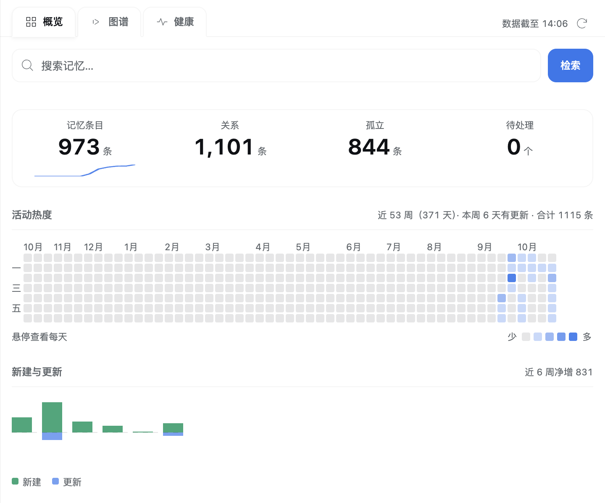
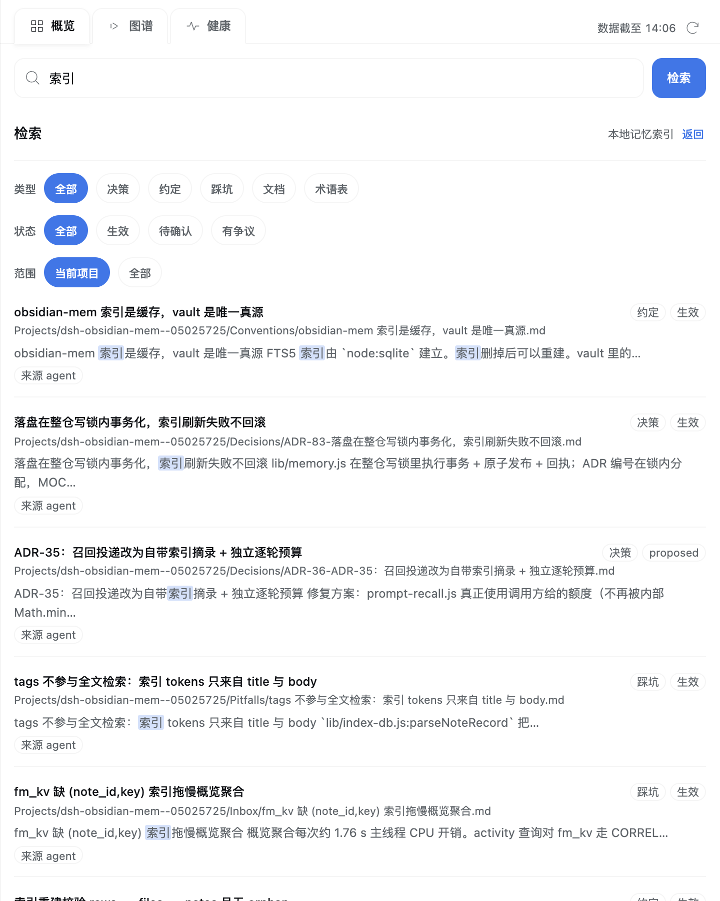
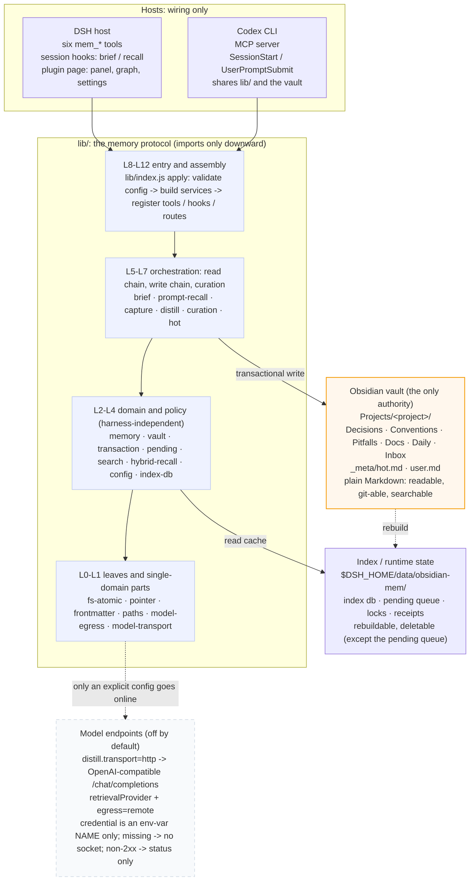
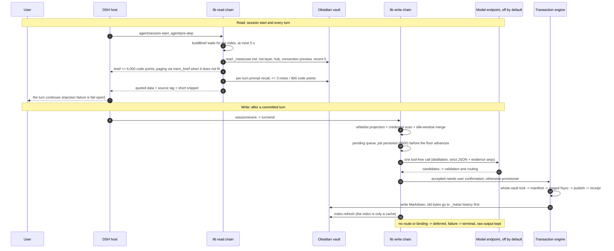

# dsh-obsidian-mem

> Long-term project memory as plain Markdown in an Obsidian vault: readable by people, diffable by git, readable by any tool. The AI is only one adapter that writes and maintains it.

`2.2.0` · MIT · Node `>=22.22.2` · DSH `>=0.1.5-rc.2` · two runtime dependencies (`@deepseek-ai/schemastery`, `yaml`) · Obsidian optional

---

## What it is

Most "AI memory" is a store you cannot open, cannot move, and cannot audit: context gets truncated, summaries get overwritten, and a retrieval result is just a score. This project does the opposite: **the memory medium is an ordinary Markdown repository**.

Each project commits a `.obsidian-mem` pointer at the repo root (only a stable `projectId` and a display name — no local path). The plugin writes that project's decisions, conventions, pitfalls, documents, daily log and hot layer as notes in the vault; DSH sessions receive a budgeted navigation brief plus a few relevant snippets, so "what was remembered, and why it was recorded that way" stays readable by both the model and the user. Turn the plugin off and the vault still reads, diffs, greps and clones. Change the harness and the memory is still there.

Three chains make up the whole system:

| Chain | When it runs | What it produces |
|---|---|---|
| Read | session start and every turn | brief (≤6,000 code points) + per-turn recall (≤3 notes / 900 code points) + six explicit tools |
| Write | turn end or a tool call | one tool-free distillation call → strict JSON validation → transactional write into the vault → index refresh |
| Audit | any time | sidebar panel (overview / graph / health), diagnostic events, replayable receipts |

It is **not** a vector database, a SaaS, or a tool that takes over your personal knowledge base. It is a memory protocol plus two adapters (the DSH host plugin and a Codex CLI MCP + hooks adapter) sharing a single `lib/` implementation.

---

## How it differs from typical memory systems: six mechanisms

| Typical approach | What this project does | Why |
|---|---|---|
| Memory lives in the cloud or in an opaque store | **The vault is the only authority**; the index is a rebuildable cache outside the vault; the pointer is committed to the repo | Memory can be read by a person, versioned by git, grepped, and survives the plugin's disappearance |
| New information overwrites old memory | **Lifecycle**: `supersedes` chains, `contested` notes with evidence on both sides, `assertion: stated/inferred/observed` + `confidence` + `review_after` | Memory is valuable because it is traceable: no history deletion, no silent winner |
| Dump the whole vault or a summary into context | **Navigational, budgeted injection**: brief 6,000 code points, hot layer 9,000, per-turn recall 900, snippet ≤200 | The budget is a design constraint, not an afterthought; when content does not fit, paging entries make the omission auditable |
| Bind memory to one chat tool or plugin API | **Protocol layer + adapter layer**: vault layout, frontmatter vocabulary and distillation contract are harness-independent | Switching harnesses does not lose memory; a third adapter can be built on the same protocol |
| `fs.writeFile` straight into Markdown | **Transaction engine**: whole-vault lock → manifest → staged bytes + fsync → publish → receipt; old bytes first go to `_meta/.history` | Crash-recoverable, concurrency-detectable, and human edits are never overwritten |
| Wire up a vector store and call it "semantic memory" | **Three-tier recall** (strong / weak / abstain) + calibrated gates + fallback; measure the lexical ceiling before fusing | Weak matches are neither silenced nor invented; every threshold has an artifact on a frozen corpus |

---

## How these advantages were built

This section is the project's "how we worked" record: each advantage maps to a measurement, a rejected design and a cost we kept.

### 1. Accept that it does not fit, then turn injection into auditable navigation

On a real vault snapshot (877 files / 1,009,768 B), the old brief spent **5,960 of its 6,000** code points but emitted only **37 of 181 navigation units (20.4%)**; 144 were omitted with no id and no paging. Listing every convention name would take about **23,800 code points — four times the budget**.

The fix was not "raise the budget" (the 12,000/24,000 proposals were rejected for cache economics and lost-in-the-middle risk):

- inside the budget, put only **navigation units** (project identity, convention preview, recent decisions/pitfalls, hot-layer constraints and in-progress items);
- the index provides bulk `statusesForPaths`, and `buildBrief` must stay under 1 s at 2,000 conventions or the preview is not published;
- coverage accounting `{sections, considered, shown, omitted}` must satisfy an identity, and every page is ≤8,000 code points.

Measured outcome: the brief went from 5,960 → **2,135 / 6,000** code points; inline conventions 37/176 → **5/176** (46 superseded and 31 provisional entries excluded); recent 5 decisions/pitfalls 0/5 → **5/5**; paging 176/176 exact; warm median **175.2 → 156.7 ms**. These are single-machine descriptive numbers, not cross-machine guarantees.

### 2. Recall: measure the lexical ceiling, then add only channels with measurable gain

On a frozen 200-query corpus (5 classes × 40, Cohen κ = 0.893), the lexical baseline scored pooled P@3 **44.4% (71/160)**, in-gate precision 20.1% and no-answer FPR 50.0%; its failure mode was "the candidate set is empty or wrong".

The dense channel was added only after acceptance criteria were fixed: P@3 ≥60%, the exact class must not regress, no single-class loss >3pp, and byte-identical results to lexical when the provider is off. Weighted RRF (lexical 1.0 / dense 2.0 / k=60) with an adaptive lexical guard (keep lexical order when top-1 is a title-exact hit or tokenHits ≥8) produced:

- pooled P@3 **44.4% → 61.25% (98/160)**; exact **held at 96.9** (removing the guard drops it to 87.5, so the guard is part of the design);
- paraphrase 53.1 → 84.4, concept 37.5 → 59.4, deictic 18.8 → 43.8, cross-lingual 15.6 → 21.9;
- with the production Qwen3-Embedding-0.6B model, pooled P@3 **70.6%**; the old gate admitted only 23.3%, so the gate had to be recalibrated — token floor **6** (in-gate 39.8% / FPR 5.0%), weak tier at **cosine 0.55 + margin 0.02** (real promptRecall replay coverage **142/200 = 71%**).

Rejected designs are recorded too: dense replaces lexical (exact P@1 0.531 vs 0.906); unguarded RRF; hybrid-rank-only gate; linear blending (<53%); sqlite-vec (brute force over 1k vectors <1 ms). Two real engineering problems surfaced later: long prompts were truncated (86/200, P@3 70.6→61.9) → dense queries now use the full text capped at 800 code points; the lexical query plan scanned the whole FTS table (p50 202.5 ms) → unary `+` prefixes plus pinned bm25 weights cut lexical p50 to **22.3 ms** and hybrid p50 to **121.2 ms** (the remaining ~99 ms is one loopback embedding round trip).

Explicitly unmeasured: live trigger rate, the real effect of the 900-code-point injection budget, and the parts of cross-lingual/deictic that are bounded by candidate recall (the gold note is absent from the lexical union 44% and 37.5% of the time respectively).

### 3. Failure memory: only grows from "three hard failures in one turn plus a later success or explanation"

Failures become memory, but the source is tightly controlled: only **three hard failures of the same tool in one turn** create a candidate; filing it requires the hard failures, a later verified success of the same tool, and an explanation from the user or the final answer. The note is `assertion: inferred`, `status: provisional`, and the root cause is **never** marked `observed`. Tool output, commands, paths and credentials are never copied.

Measured: after three hard failures in one turn, the 39th sequence injected **230 code points** of failure recall (under the 900 cap) and all eight acceptance assertions passed; the candidate stayed in the Inbox (no user explanation), with the root cause left unknown. A successful tool call only proves "the retry worked", not the cause.

### 4. Habit learning: measure the unreliable signal to death, and count "do not learn" as a result

This is the most counter-intuitive falsification in the repository. The first design extracted "tool preferences" from 137 real session logs (40 root sessions, 107 usable turns, 178 user messages, 6 projects, 67.9 days). Replay showed that **291 of 294 tool choices (99.0%) never appeared in that turn's user message** — it was measuring the agent's default behaviour; and 205/341 (60%) of signals appeared in only one project, so they are project properties, not user habits. Decay could not save it either: 67.9 days is only 2.26 half-lives, and **0 of 9** `习惯：` notes were ever `observed`.

The corrected contract: only **the user's own words repeated across sessions** count. The 6 candidates from a 12-word durable-instruction vocabulary seen in ≥3 sessions covered all 3 real cross-project preferences. A noise stress measured **67%** false promotion of one-off mentions; raising the threshold to 9 cleared the noise but lost real preferences — so the defence moved from "tune the threshold" to **isolation**: candidates are provisional + observed and stay out of the brief, so a wrong one merely adds a pending review item; the 75% false-promotion upper bound is pinned in a test. A semantic classifier detected 7/8 and 5/8 across two runs with 0/16 false positives on 24 labelled samples — evidence of variance, not production accuracy.

### 5. Write safety: a transaction engine, not direct file writes

Every write path (six tools, automatic distillation, curation proposals) shares one transaction:

1. take a whole-vault lock keyed by the vault realpath (the lock file lives in the data root, not the vault); an unfinished-transaction list makes recovery possible;
2. write the manifest, then stage all bytes and fsync;
3. publish new files with exclusive `link()`, replace old files with a same-directory rename; copy old bytes into `_meta/.history/<txId>/` before modifying;
4. a receipt records txId, session/seq, actions, paths, before/after hashes; replaying the same txId is idempotent.

Boundaries: human files (`trust: owner`, no plugin ownership record, or edited since the last write) are **never rewritten** — suggestions only go to `收件箱/`; rollback is allowed only while the current hash equals what this transaction wrote; after a crash, unfinished transactions are recovered before any new work. A SIGKILL probe produced exactly one receipt after restart, no duplicate note id, and zero vault changes in dry-run; residual boundaries (one-shot lifecycle window, "job still pending after process exit") live in CHANGELOG rather than in a README claim of completion.

### 6. Engineering gates: make "not done" impossible to write as "done"

- The first ESLint run caught a published defect: `lib/vault.js:504` referenced a `TransactionError` that was re-exported but never imported, so a short-circuit left a `ReferenceError` path on registry-transaction failure (present since 8c988dd, untested).
- `engines.node >=22.22.2` is a measurement: SQLite 3.47.2 in Node 22.13.0 has **no FTS5**; 22.22.2 and 25.9.0 do; 22.14–22.21 are untested.
- Architecture and size are tests: `test/architecture.test.js` reads the real import graph, requires no cycles, downward-only edges and no same-layer imports, and enforces a budget of "measured lines + 30, rounded up to 50" so no module grows silently.
- Dogfooding really does falsify the README: the 12-item checklist passed 10, and item F1 falsified the "binding happens on first write" claim → an automatic binding path and 15 real-seam cases were added, 558/558.
- The gate grew from 574 tests / 33 files to **1,787 tests / 1,786 pass / 0 fail / 1 skipped** on this branch, with a tarball of 98 entries / 88 lib modules; every release runs `npm run check` (lint → format:check → types → prepack → real tarball).

---

## Visualization: background-written memory needs an audit surface

### Why it is needed

Memory is not written by the user in the moment: the plugin captures, distils and curates it in the background and writes it into the vault. Readable Markdown is not enough — the user needs to see **what was recorded, how far curation got, why retrieval answered the way it did, and which actions can write**. The panel addresses four real problems:

- **Recall quality is not visible**: diagnostics are deliberately content-blind; hybrid recall has a measured gain (P@3 44.4→61.25%) but the user cannot see why a recall happened.
- **Curation approval was terminal-only**: at ADR-282 the queue held 20 pending and 16 rejected items. Most curation needs no human, but the small part that does should not require a terminal. Now the panel, the CLI, and bounded automatic review all funnel into the same write entry point.
- **Background maintenance is opaque**: index, queue, hot layer and today's digest are four gauges. One real production defect only appeared once rendered — the route asked for 371 days of activity while `MAX_ACTIVITY_DAYS` was still 365, so a `RangeError` turned `activity` into `null`.
- **Memory changes must be visible without restarting DSH**: the server rescans the index at most every 5 seconds and the client polls every 15 seconds; only a plugin upgrade needs a restart.

In one sentence: the panel is the **audit surface** for background-written memory, not decoration.

### What the panel shows today

- **Overview**: KPI band (notes / links / orphans / pending + sparkline) → a fixed 371-day / 53-week activity heatmap → new-vs-updated flow bars → type × status composition (falls back to a stacked bar when real joint counts are unavailable — it does not fake flows) → tag-frequency treemap → recent-changes timeline. The overview has a 20 KiB payload budget; real 371-day answers measure 13,910–14,138 B.
- **Graph**: **no truncation** within scope — every node is drawn. The force layout is a 1:1 port of Obsidian 1.14.4's D3 fallback (after 300 ticks on a 400-node/592-edge graph the max deviation from Obsidian is **0.000**, versus 530.1 for the earlier worker). Default colours are five Morandi groups; the label layer has 60/200/240 guards so dense graphs stay responsive.
- **Health**: four gauges plus index / pending jobs / hot layer / today's digest / diagnostics sections and a "pending review" card. There are **five write actions** (retry job, compact hot, publish digest, approve proposal, reject proposal), all preview → confirm with a single-use 60-second token bound to session / project / operation / arguments / preview fingerprint.
- **Search**: retired from a tab to the shell search box; its results page is **lexical FTS5** (`index.search`) — it answers "which text matches", it does **not** run hybrid semantic recall. Do not equate the two.

### Evolution: every round driven by measurement

- The first "vault ledger" visual from 2026-10-27 was retired the next day: an imposed serif, Chrome-style tabs, duplicated idle copy, fake times and self-contradicting counts. The 2026-10-28 modern redesign replaced it (42px tab bar, roving tabIndex, a single state machine, Windows CI + `.gitattributes`).
- Chart rounds all have pixel/byte evidence: the treemap label predictor underestimated text width by 32–52% → after the fix all 24/24 labels had names at 659px (16 before); `rx:2` cut a notch into the zero line at stretched coordinates; the four KPI cells were recentred from left-aligned to x=93.63; the fixed 53×371 heatmap brought the 371-day payload to 13,910 B; round 5 measured 53/53 fence checks and a 14,138 B budget margin.
- The graph first fixed collision loss: with 1,236 nodes / 1,417 edges the median minimum neighbour distance went 51.85 → 112.07 after collision was restored; the same night it was replaced by the Obsidian-identical simulation (deviation 0.000), at the cost of giving up Obsidian's wasm/SAB fast path.

### An experiment we measured and reverted: the semantic map

On 2026-11-03 we tried a PCA 2-D projection of the embedding cloud so users could "see why hybrid retrieval got better". On a real 1,400+ note vault the first semantic call measured **1,315 ms** against a 300 ms budget, a **174,915 B** payload against a 48 KB budget, PCA `explained` **0.0913**, and a renderer at **1.3 GB RSS / ~50% CPU**. After the user tried it on a real desktop, they asked for a revert: the semantic channel improved memory search, but the visualization was not necessary.

The revert removed only the visualization (`lib/semantic-map.js`, `lib/recall-trace.js`, `lib/graph-semantic.js` and their actions/client code) and **kept** hybrid retrieval plus the generic label-density guard added in the same commit. This is a "we tried it, measured it, and said no" example, not an unbuilt idea.

### Screenshots





> These screenshots were captured in the 2026-10-31 content round. Since then the health page gained four gauges and a review card, and the graph defaults to Morandi group colours; when this README was rewritten these images were known not to be pixel-accurate for 2.2.0.

---

## Architecture: one protocol, two adapters, one transaction engine



In three sentences:

1. **The product is the vault**, not the plugin: `lib/` only translates sessions, models and timing into Markdown; the index and caches are rebuildable, and the vault is the only authority.
2. **Two reliable chains**: the read chain injects budgeted navigation and a few snippets at session start and on every turn; the write chain stages a committed turn in a durable queue, makes one tool-free model call to extract decisions/pitfalls/conventions, and applies them through the transaction engine.
3. **One implementation serves two entry points**: the DSH host plugin (tools + hooks + optional web routes) and Codex (an MCP server + two hooks); there is no second memory implementation.

### Three reads and one write chain per session



| Path | When | Budget / constraints | Failure mode |
|---|---|---|---|
| Session brief | session start; at most one delta when hot changes | 6,000 code points; paging via `mem_brief` when it does not fit | fail-open, never blocks a turn |
| Per-turn prompt recall | every `agent/pre-step`, query from the real user message | ≤3 notes, 900 code points, snippet ≤200 | no useful content → at most one abstain notice per session |
| Six tools | model-initiated | closed contract: `mem_search / mem_read / mem_write / mem_log / mem_brief / mem_admin` | structured errors returned, never thrown at the host |
| Automatic distillation | after `turn/end`, through the queue | one tool-free call; strict JSON + evidence seqs; maxItems 12 | no route → deferred; failure → terminal, raw output retained |
| Transactional write | after a candidate validates | whole-vault lock, staged + fsync, publish, receipt | conflict → keep current bytes and stop automatic writes |

### Hard invariants (excerpt)

| Invariant | Why |
|---|---|
| The vault is the only authority; the index is rebuildable | The plugin or the index can disappear without damaging memory |
| Every vault write goes through the transaction engine | Crash recovery, concurrency detection, no overwriting human edits |
| Zero modification of human files | The plugin only writes its own machine-owned domains; suggestions go to `收件箱/` |
| Only machine-owned domains (decisions/conventions/pitfalls/task state/docs), never "insights about the user" | `_meta/user.md` belongs to the user; external material is linked, never summarized into memory |
| Injection is budgeted, source-tagged **quoted data** | Vault content must not become instructions; over-budget content is paged, not truncated |
| `turn/end` persists before any model call; the receipt is written before the job is deleted | At-least-once delivery; a restart never re-calls the model for the same work |
| Network is off by default; `egress: remote` is an explicit decision | Endpoints may be local or remote; credentials appear only as environment-variable names |
| The six tools are the model's only interface, with a closed contract | Changing harness does not lose semantics; Codex derives from the same `TOOL_PARAMETERS` |
| Diagnostics are content-blind and never throw | They can be attached to an issue without leaking bodies, paths, queries or keys |
| Architecture and file size are tests, not conventions | No cycles, downward-only, no same-layer imports; growth requires an explicit decision |

### Layers

`lib/` has 88 modules in L0–L12, and imports may only go downward: entry and assembly (L8–L12) → orchestration and background work (L5–L7) → domain and policy (L2–L4: memory, vault, transaction, pending, search, hybrid-recall, config, index-db) → leaves and single-domain parts (L0–L1: fs-atomic, pointer, frontmatter, paths, model-egress, model-transport). Layer numbers and line budgets are enforced by a test that reads the real import graph.

### Two entry points

| | DSH host plugin | Codex CLI adapter |
|---|---|---|
| Entry | Cordis `apply`: tools, session hooks, web routes, client bundle | MCP stdio server + `SessionStart` / `UserPromptSubmit` hooks |
| Read | brief and recall injected at session start / each turn | the same brief through hook output; prompt recall mirrored |
| Write | automatic distillation after `turn/end` | no turn boundary; notes via explicit tool calls |
| Panel | overview / graph / health / settings page | none (a behavioural difference, not a defect) |
| Shared | vault protocol, transaction and locks, retrieval policy, six-tool schema, data root, skill, frontmatter vocabulary | same |

### Where data lives

| Location | Contents | Authoritative? |
|---|---|---|
| repo root `.obsidian-mem` | four-field pointer: `projectId` / `slug` / `displayName` / `schema` | yes (identity) |
| vault (default `~/Documents/dsh-memory`) | `Projects/<slug>--<id8>/` with Docs / Decisions / Conventions / Pitfalls / Daily / Inbox, `_meta/`, `Methods/` | **the only authority** |
| `$DSH_HOME/data/obsidian-mem/` | index, pending, locks, transactions, receipts, diagnostics, session/route state | cache and runtime state; deletable except the pending queue |
| DSH persisted session state | injected/displayed paths, hot version | no bodies or prompts |

---

## Quick start

### Requirements

| Dependency | Requirement | Basis |
|---|---|---|
| Node | `>=22.22.2` | 22.13.0 has `node:sqlite` but no FTS5; 22.22.2 and 25.9.0 are tested; 22.14–22.21 are untested |
| DSH | `>=0.1.5-rc.2` (declared in `engines.dsh`) | verified on 0.1.5-rc.2 through 0.2.1-rc.5; installed hosts do not read this field, it is a declaration |
| Obsidian | optional | the vault is a plain directory; read/write works without Obsidian |
| OS | Windows / macOS / Linux | CI covers Ubuntu and Windows; macOS uses the same portable path. The curation-review `O_NOFOLLOW` protection is macOS/Linux-only; reads and writes are unaffected |

### Five-minute install

1. **Choose a dedicated vault directory** on a local disk (iCloud / cloud-storage paths are refused), not inside your personal knowledge base.
2. **Verify on a throwaway profile first**:

   ```sh
   export DSH_HOME=$(mktemp -d)
   dsh plugin --profile memcheck add github:bonerush/dsh-obsidian-mem
   dsh --profile memcheck --dump-config | grep -n obsidian-mem
   ```

   Expected: `- id: obsidian-mem` and `name: dsh-obsidian-mem`. Pin production to a commit: `...add github:bonerush/dsh-obsidian-mem#<commit>`.

3. **Install into the profile you actually use**:

   ```sh
   dsh plugin --profile web add github:bonerush/dsh-obsidian-mem
   ```

   For a local checkout use `"link:$PWD"` as the dependency.

4. **Fully restart DSH** (plugins load once per process), then open a new session.
5. **Open the vault directory in Obsidian** as a vault. The plugin creates the project directory on the first write; it never edits existing notes or the type registry, and only runs `git init` on a directory it just created (and never commits).

### Verify it works

| Check | Expected |
|---|---|
| Plugin mounted | an `obsidian-mem` row in the plugin list |
| Project bound | the first `mem_write` / `mem_log` binds a pointerless Git repo; reads never auto-bind; a non-Git directory stays read-only until an explicit `mem_admin` bind |
| Brief injected | once per session, ≤`briefBudgetChars` |
| Hot continuation | ≤2 automatic continuations, without changing the session generation |
| Convention preview | rotates from a persisted anchor; a 176-convention vault is fully visible across session starts |
| Recall | at most 3 matching notes per turn, ≤900 code points |
| CJK search | single-character and multi-character CJK queries both hit |
| Vault files | real Markdown you can open, not a database export |

---

## Configuration

### Edit from the plugin page

The DSH plugin detail page's configuration section edits every field (Basic / Capture and curation / Context budget / Model distillation / Retrieval / Other). Saves go to `$DSH_HOME/profiles/<profile>/cordis.patch.yml` and reload in about 1–2 seconds; the page switch is `enabled`, which is not part of the form.

- A row supplied by the home layer `$DSH_HOME/cordis.patch.yml` overrides the profile row, and the page is read-only in that case.
- Patch layers do **not** deep-merge: an inline `config:` must list the whole object (including `distill`).
- Unknown keys are load errors, not no-ops.

### Key fields

| Field | Default | Meaning |
|---|---|---|
| `vaultPath` | `~/Documents/dsh-memory` | must be on a local disk |
| `initGitOnCreate` | `true` | `git init` only in a vault directory this plugin just created; never commits |
| `injectBrief` / `bindHint` | `true` | brief injection; the one-time unbound-session hint (`bindHint`) |
| `briefBudgetChars` / `recallBudgetChars` | `6000` / `900` | two independent budgets; per-turn recall does not consume the brief |
| `briefConventionMode` | `summary` | `summary` gives an addressable preview; `flat` lists every name (more expensive) |
| `hotCapacityChars` / `hotArchiveRatio` | `9000` / `0.67` | hot-layer storage cap; over-capacity folds `已完成` items into pointer lines |
| `autoCapture` / `autoCurate` / `autoReview` | `true` | `autoCurate` only controls automatic curation triggers; the panel and CLI keep working |
| `captureIdleMs` | `90000` | consecutive turns within the idle window merge into one distill job |
| `retrievalEngine` | `hybrid` | `lexical` / `sparse` / `hybrid`; with no provider configured, hybrid falls back to lexical and records why |
| `retrievalProvider` | `enabled:false`, `egress:loopback` | once enabled: `egress` (loopback / remote), `apiStyle` (embed / openai), `endpoint`, `model`, `dimensions`, `timeoutMs`, `rerank` |
| `retrievalProvider.apiKeyEnv` | `""` | the **environment-variable name**, not the secret; read immediately before the request; missing → `provider-credential` with no socket opened |
| `distill.transport` | `host` | `host` uses the host llm (endpoint must be empty); `http` calls an OpenAI-compatible `/chat/completions` directly, so Codex / TUI / CLI can distil too |
| `distill.egress` / `endpoint` / `apiStyle` / `apiKeyEnv` | `loopback` / `""` / `openai-chat` / `""` | same egress rules as retrieval; `http` requires an endpoint, `host` forbids one |
| `distill.maxItems` / `minConfidence` | `12` / `0.75` | over-limit batches are refused whole; below min confidence goes to the Inbox |
| `distill.maxInputChars` / `maxOutputTokens` / `timeoutMs` / `maxRetries` | `24000` / `4000` / `60000` / `3` | failure is terminal and keeps the raw output; retry is explicit |
| `distill.dryRun` | `false` | writes run receipts only, no vault changes; use it first when wiring a remote route |
| `indexBackend` | `auto` | `auto` falls back to scan and reports when FTS5 is unavailable; `sqlite` fails loudly |
| `ignoreGlobs` | `[]` | only `*` / `**` / `?` and path characters; absolute paths, `..`, negation, braces and character classes are refused |

Curation proposals can be approved from the panel (Health → pending review), from the terminal via `dsh-obsidian-mem-review --vault <path> <id>`, or by bounded automatic review. Automatic curation must **never** silently merge, archive, supersede or delete a source note.

---

## Privacy and security boundaries

- **Persist before send**: a whitelisted projection (real user messages, final assistant reply, tool names + success/failure, bounded file paths) is written under `$DSH_HOME/data/obsidian-mem/pending/` with 0700/0600 before any model call; raw session transcripts never enter the vault.
- **Never sent**: plugin injections, reasoning blocks, raw tool output, tool arguments, subagent transcripts, credential files, environment variables.
- **Credential scrub**: a deterministic scan **skips the whole message** when it looks like a credential and records it; it is not exhaustive, so unrecognised secrets may still reach the model.
- **Destination**: only the configured model route or the session's last recorded route; without a route the job is deferred, never defaulted; no telemetry.
- **Egress**: `egress: loopback` accepts the literal `127.0.0.1` / `::1` only; `remote` is an explicit decision recorded on the search diagnostic. Endpoints reject embedded credentials, query strings and fragments; redirects are never followed; non-2xx responses report the status only and never echo the upstream body; secrets are removed from errors/diagnostics/logs via `redactSecret`.
- **Panel**: read-only baseline; only the five preview → confirm actions can write; loopback / same-origin fences (including the `dsh-app://` proxy).

---

## Honest limits

These are design boundaries, written down so you can judge the tool before enabling writes:

- The index is only a cache; the vault is the source of truth. The index can be deleted and rebuilt, but the pending queue under the data root must not be thrown away casually.
- The vault must be on a local disk: iCloud / CloudStorage are refused (dataless placeholder reads are unsafe, and sync clients can misread placeholders as deletion); unknown providers pause and report. Only the two documented macOS roots are claimed.
- Obsidian's `.obsidian/types.json` property registry **cannot be read offline**: preflight sees only types present in note bytes, reads at most the first 64 KiB, and reports the bound.
- Dates never come from mtime / ctime / birthtime; the index uses mtime+size only as a staleness hint.
- Hard links and bind mounts are invisible, and a TOCTOU window exists between `lstat` and `open`; the transaction narrows it with exclusive creation, hash verification before replacement, snapshots before modification and stopping on conflict. The threat model is single-user local, not a multi-tenant sandbox.
- Semantic retrieval is bounded by candidate recall: cross-lingual and deictic gold notes are not guaranteed to be in the lexical union; `sparse` cannot find synonyms the index never matched; the 900-code-point injection path has not been measured in real sessions. Hybrid live trigger rate, near-miss frequency, and the weak-tier threshold's applicability to other models are unverified.
- A receipt is an observation that something was delivered, not proof the model paid attention; panel writes are preview-confirmed, not two-phase-committed (replay works within 60 seconds); the cross-process lock is the least-tested part of the repository.
- The authoritative list of unverified items is `CHANGELOG.md` (1.0.0's *Known limitations and remaining risks* plus every Unreleased entry). This README neither repeats nor exhausts it.

---

## Failure recovery

| Symptom | First look / action |
|---|---|
| `vault-cloud-managed` | the vault is on a cloud path; move it to local disk |
| A file got offloaded | updates for that file pause and are never written as empty; retry after it returns to local |
| Property-type conflict on bootstrap | the plugin never rewrites note frontmatter; fix the property or choose another directory |
| Write / generated-block hash conflict | current bytes are kept and automatic writes stop; reconcile by hand |
| Search not-ready | `mem_admin` index status / rebuild; the vault is untouched |
| Job failed | `mem_admin` jobs + retry; `too-many-items` is terminal but keeps raw output, and raising `maxItems` then retrying re-validates stored text without a new model call |
| Job deferred | no route / no binding / validation refusal; retried in each idle window |
| After a crash | unfinished transactions recover on startup; a corrupt lock file can be deleted individually; a dead holder is reclaimed by pid |
| hot-over-capacity | `mem_admin` hot status → hot compact; still full → raise `hotCapacityChars` |
| The repository refuses writes | remote mismatch / projectId conflict / sibling worktree: `mem_admin` bind show / retain / fork; the plugin never edits the pointer automatically |
| A plain directory stays read-only | `mem_admin` bind local |
| Memory silently absent | unbound reads never build memory; check `mem_admin` projects. Reads never bind; the first write does |
| A curation proposal stays pending | by design; `dsh-obsidian-mem-review --vault <path> <id>` or the panel's pending-review card |
| The brief looks stale | client cache; the next complete scan rebuilds it |

---

## Development and releases

```sh
npm ci                  # install exactly the lockfile
npm test                # throwaway DSH_HOME + node --test test/*.test.js
npm run check           # lint -> format:check -> types -> prepack (suite + pack contract) -> pack:check (real tarball)
npm run prepack         # read-only: suite + package contract, never builds, never launches Obsidian
```

- `npm run types` is a **per-file ratchet**: only files listed in `tsconfig.json` and marked `// @ts-check` are checked, and `test/repo-hygiene.test.js` keeps the two lists equal.
- Architecture rules live in `test/architecture.test.js`: real import graph, L0–L12 layers, downward-only, no cycles, no same-layer imports, and line budgets (measured + 30, rounded up to 50).
- Releases are not `npm publish`: a release is a git tag plus a GitHub Release. `release.yml` runs `npm run check`, asks the remote whether this version already has a tag, and if not bootstraps: tags the commit, publishes the Release with `dsh-obsidian-mem-<version>.tgz`, and moves the marketplace entry. If the tag exists, a lib/ change without a real Unreleased entry is refused, the patch is bumped and the changelog section is moved. Since 1.0.0, the six tool names/parameters, the vault protocol and the config keys are SemVer compatibility promises.
- The README pair is bilingual: `README.md` and `README.zh.md` change in the same commit, then `git hash-object README.md README.zh.md` is written back into `README.i18n.yaml`.

---

## License

MIT. The D3 modules bundled into the graph worker (`d3-force` / `d3-quadtree` / `d3-dispatch` / `d3-timer`) are ISC; their notices are collected in `lib/graph-worker.LICENSE`. The force-layout constants are ported from Obsidian 1.14.4's D3 fallback; provenance and measurements are in `docs/obsidian-graph-source.md`.

## Further documentation

- [`docs/guide/`](docs/guide/README.md): the one-hour project guide (concepts, architecture, sessions, storage, reliability, troubleshooting, Codex)
- [`docs/p0-compatibility.md`](docs/p0-compatibility.md): measured host facts (sessions, events, `ctx.llm`, injection timing)
- [`CHANGELOG.md`](CHANGELOG.md): capabilities and unverified items for every version
- [`docs/dogfood-results.md`](docs/dogfood-results.md) and [`docs/smoke-results.md`](docs/smoke-results.md): end-to-end run records
