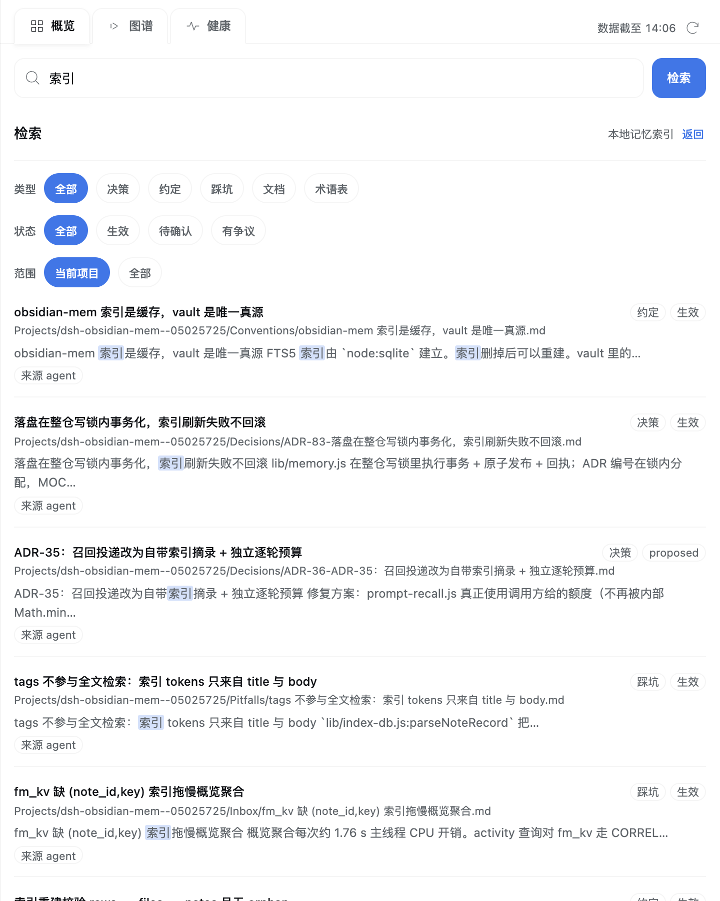
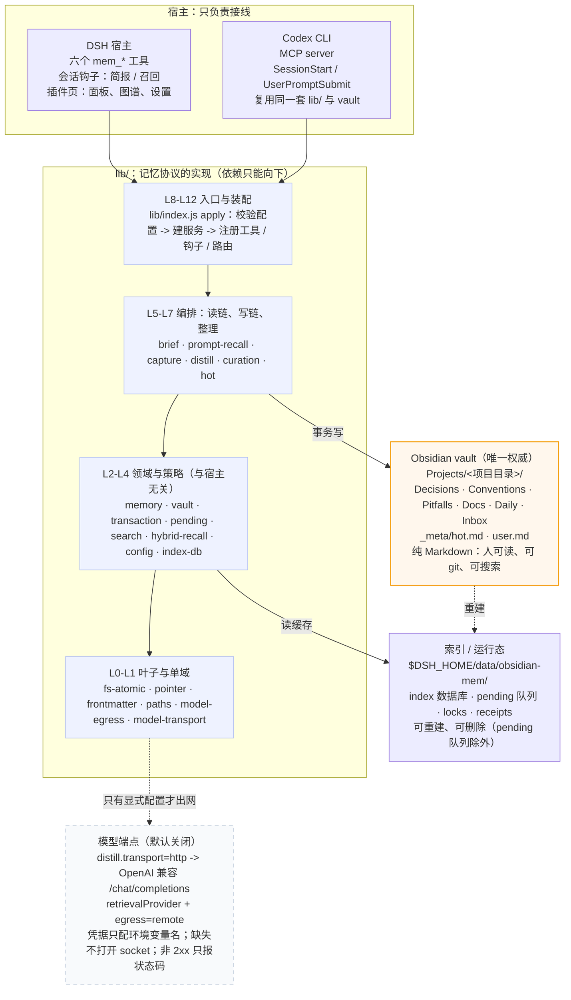
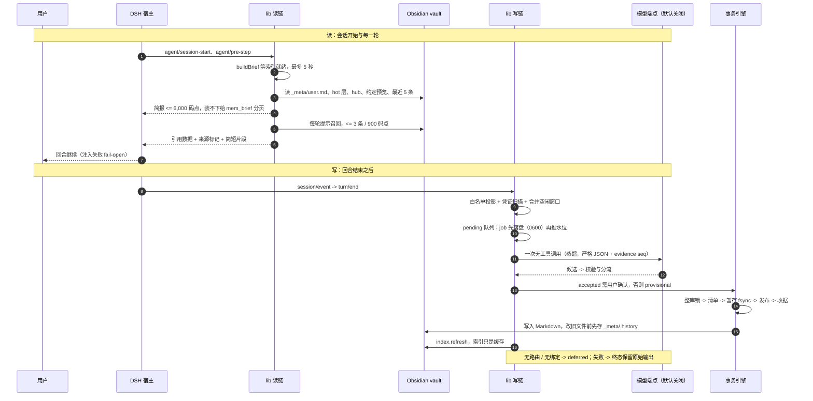

# dsh-obsidian-mem

> 把每个项目的长期记忆写成 Obsidian 里的纯 Markdown：人可读、可 git、可被任何工具读取。AI 只是写入和维护它的一个适配器。

`2.2.0` · MIT · Node `>=22.22.2` · DSH `>=0.1.5-rc.2` · 两个运行时依赖（`@deepseek-ai/schemastery`、`yaml`）· Obsidian 可选

---

## 它是什么

大多数 "AI 记忆" 是一个你打不开、搬不走、也审不了的存储：上下文被截断、摘要被覆盖、检索结果只有一个分数。这个项目反着做：**记忆的载体是一份普通 Markdown 仓库**。

每个项目在仓库根提交一个 `.obsidian-mem` 指针（只有稳定的 `projectId` 与显示名，不含本机路径）。插件把该项目的决定、约定、踩坑、文档、日志与热层写成 vault 里的笔记；DSH 会话自动注入一份带预算的导航简报和少量相关片段，把"记了什么、为什么这样记"放在模型和用户都能读到的地方。关掉插件，vault 仍然可读、可 git、可搜索；换一个 harness，记忆仍然在。

三条链路构成全部行为：

| 链路 | 时机 | 输出 |
|---|---|---|
| 读 | 会话开始与每一轮 | 简报（上限 6,000 码点）+ 每轮召回（≤3 条 / 900 码点）+ 六个显式工具 |
| 写 | 回合结束或工具调用 | 一次无工具调用的蒸馏 → 严格 JSON 校验 → 事务写入 vault → 刷新索引 |
| 审计 | 随时 | 侧边栏面板（概览 / 图谱 / 健康）、诊断事件、可重放的回执 |

它**不是**：一个向量数据库、一个 SaaS、或一个接管你个人知识库的工具。它是"记忆协议 + 两个适配器"（DSH 宿主插件、Codex CLI 的 MCP + hooks 适配器），两个入口复用同一套 `lib/` 实现。

---

## 和典型记忆方案的区别：六处机制

| 典型做法 | 这个项目怎么做 | 为什么 |
|---|---|---|
| 记忆存在云端或某个黑盒库里 | **vault 是唯一权威**，索引只是 vault 之外的可重建缓存；指针提交进仓库 | 记忆能被人直接读、被 git 版本化、被 grep，也能在插件消失后继续存在 |
| 新信息覆盖/重写旧记忆 | **生命周期**：`supersedes` 链、`contested` 双向挂证据、`assertion: stated/inferred/observed` + `confidence` + `review_after` | 记忆的价值在于可追溯：不删除历史、不悄悄选赢家 |
| 把整个 vault 或摘要塞进上下文 | **导航 + 约束**的预算化注入：简报 6,000 码点、hot 层 9,000、每轮召回 900、摘要 ≤200 | 预算不是事后优化；装不下时给分页入口，让"省略"可审计 |
| 绑定某个聊天工具/插件 API | **协议层 + 适配层**：vault 布局、frontmatter 词表、蒸馏契约跨 harness 稳定 | 换 harness 不丢记忆；DSH 与 Codex 之外还能长出第三个适配器 |
| 直接 `fs.writeFile` 写 Markdown | **事务引擎**：整库锁 → 清单 → 暂存 + fsync → 发布 → 收据；旧版本先入 `_meta/.history` | 崩溃可恢复、并发可检测、人类编辑永不被覆盖 |
| 接一个向量库就宣称"语义记忆" | **三档召回**（强匹配 / 弱匹配 / 弃权）+ 校准门 + 失败回退；融合前先量词法上限 | 弱匹配不静音、不编造；每个阈值都有冻结语料上的测量 |

---

## 这些优势是怎么造出来的

这一节是项目的"做法记录"：每条优势都对应一次测量、一个被否的方案和一个留下的代价。

### 1. 先承认"装不下"，再把注入改成可审计的导航

真实 vault 快照（877 文件 / 1,009,768 B）上，旧版简报把 6,000 码点花到 **5,960**，却只发出 181 个导航单元中的 **37 个（20.4%）**，144 条被省略且无 id、无分页；把所有约定名字列全约 **23,800 码点，是预算的 4 倍**。

改法不是"把预算调大"（12,000/24,000 的方案被否：缓存经济性与 lost-in-the-middle），而是：

- 预算内只放**导航单元**（项目身份、约定预览、最近决策/踩坑、hot 层强约束/进行中）；
- 索引提供 `statusesForPaths` 批量状态，2,000 条约定时 `buildBrief` 必须 <1 s，否则预览不发布；
- 覆盖率记账 `{sections, considered, shown, omitted}` 必须满足恒等式，每页 ≤8,000 码点。

实测结果：简报从 5,960 → **2,135 / 6,000** 码点；内联约定 37/176 → **5/176**（46 条 superseded、31 条 provisional 被排除）；最近 5 条决策/踩坑从 0/5 → **5/5**；分页 176/176 精确；warm 中位 **175.2 → 156.7 ms**。这些是单机描述性数字，不是跨机保证。

### 2. 召回：先量词法天花板，再只加"可测增益"的通道

冻结 200 查询语料（5 类 × 40，Cohen κ=0.893）上，词法基线 pooled P@3 **44.4%（71/160）**，in-gate 精度 20.1%，no-answer FPR 50.0%；失败模式是"候选集为空或错"。

于是加入稠密通道，但融合前先立验收条件：P@3 ≥60%、exact 类不降、没有单类损失 >3pp、provider 关闭时与词法**逐字节一致**。加权 RRF（lexical 1.0 / dense 2.0 / k=60）+ 自适应词法守卫（top1 标题精确命中或 tokenHits ≥8 时保词法序）的结果：

- pooled P@3 **44.4% → 61.25%（98/160）**；exact **96.9 保持**（去掉守卫会掉到 87.5，所以守卫是设计的一部分）；
- paraphrase 53.1 → 84.4，concept 37.5 → 59.4，deictic 18.8 → 43.8，cross-lingual 15.6 → 21.9；
- 生产模型 Qwen3-Embedding-0.6B 上 pooled P@3 **70.6%**，旧门只放行 23.3% → 召回门必须按数据重调，token 下限取 **6**（in-gate 39.8% / FPR 5.0%），弱匹配档落在 **cosine 0.55 + margin 0.02**（真实 promptRecall 重放覆盖率 **142/200 = 71%**）。

被否决的方案也都留了记录：用稠密替换词法（exact P@1 0.531 vs 0.906）；无守卫 RRF；只看混合 rank 过门；线性混合（<53%）；sqlite-vec（1k 向量暴力 <1 ms）。后来还发现两个真实的工程问题：长提示被截断（86/200，P@3 70.6→61.9）→ 稠密查询改用完整文本并限 800 码点；词法查询计划全表扫 bm25（p50 202.5 ms）→ 一元 `+` 前缀 + 固定权重把词法 p50 打到 **22.3 ms**，混合 p50 降到 **121.2 ms**（残余约 99 ms 是一次 loopback embedding 往返）。

明确没测的：线上触发率、900 码点注入预算的真实效果、cross-lingual/deictic 受候选召回限制的部分（gold 不在词法并集中的比例分别是 44% 与 37.5%）。

### 3. 失败记忆：只从"同轮 3 次硬失败 + 后来的成功/解释"里生长

失败也会被记成记忆，但来源被卡得很死：同一轮里同一工具 **3 次硬失败**才进入候选；归档必须同时引用硬失败、之后同工具的已验证成功、以及用户/最终解释；`assertion: inferred`、`status: provisional`，根因**永不**标 `observed`。不复制工具输出、命令、路径或凭证。

实测：同轮 3 次硬失败后，第 39 个 seq 注入了 **230 码点**的失败召回（<900 上限），8 条验收断言通过；候选停在收件箱（没有用户解释），根因保持未知。工具成功只证明"重试成功"，不被当成根因。

### 4. 习惯学习：把不可靠的信号测死，把"不学"也当成结论

这是仓库里最反直觉的一次证伪。第一版设计从 137 份真实会话日志（40 个根会话、107 个可用轮、178 条用户消息、6 个项目、67.9 天）里提取"工具偏好"，重放后发现 **294 次工具选择中 291 次（99.0%）没有出现在该轮用户消息里**——测到的是 agent 的默认行为；且 205/341（60%）信号只出现在一个项目，是项目属性而非用户习惯。衰减也救不了：67.9 天只有 2.26 个半衰期，而 9 条 `习惯：` 笔记里 **0 条 `observed`**。

修正后的口径：只采信**跨会话复现的用户原话**。12 词持久指令词表里 ≥3 会话的 6 个候选，覆盖了全部 3 条真实跨项目习惯。噪声压测显示一次性提及的误提升率达到 **67%**，而把阈值提到 9 能清零噪声却会丢掉真实的习惯——所以防御从"调阈值"改成**隔离**：候选是 provisional + observed、不进简报，错了只多一条待审阅；75% 误提升上界被写进测试。语义分类器在 24 个标注样本上两次运行检出 7/8、5/8、误报 0/16——只证明方差，不是生产准确率。

### 5. 写安全：事务引擎，而不是直接写文件

所有写路径（六个工具、自动蒸馏、整理提案）共用同一套事务：

1. 按 vault realpath 取整库锁（锁文件在 data root，不在 vault 内），未完成事务清单可恢复；
2. 先写清单，再暂存全部字节并 fsync；
3. 新文件用排他 `link()` 发布，旧文件同目录 rename 替换；改旧文件前把旧字节复制进 `_meta/.history/<txId>/`；
4. 收据记录 txId、session/seq、动作、路径、前后 hash；同一 txId 重放幂等。

边界：人类文件（`trust: owner`、没有插件所有权记录、或上次写入后又被编辑过）**永不被改写**，建议只能进 `收件箱/`；失败回滚只在"当前 hash == 本事务写入的 hash"时允许；崩溃后启动先恢复未完成事务。SIGKILL 探针实测：重启后回执恰好 1 条、无重复笔记 id、dry-run 零 vault 变更；一次性生命周期窗口与"进程退出后 job 仍 pending"等残余边界写进了 CHANGELOG 而不是 README 的"已完成"里。

### 6. 工程门禁：让"没做过"无法写成"已完成"

- 第一次跑 ESLint 就抓到已发布缺陷：`lib/vault.js:504` 引用了一个只被 re-export、从未 import 的 `TransactionError`，短路逻辑让一条注册表事务失败路径抛 `ReferenceError`（自 8c988dd 起、无测试覆盖）。
- `engines.node >=22.22.2` 是实测结论：22.13.0 的 SQLite 3.47.2 **没有 FTS5**；22.22.2 / 25.9.0 有；22.14–22.21 未测。
- 架构与大小是测试：`test/architecture.test.js` 读取真实 import 图，检查无环、只向下、同层不互引，并用"实测行数 + 30 向上取整到 50"的预算挡住无声变胖。
- dogfood 真的会证伪 README：12 项清单 10 PASS，其中 F1 证伪了"首次写入自动绑定"的断言 → 新增自动绑定路径与 15 个用例，全套 558/558。
- 门禁规模从 574 tests / 33 文件演进到本分支的 **1,787 tests / 1,786 pass / 0 fail / 1 skipped**、tarball 98 条目 / 88 个 lib 模块；每个发布都带 `npm run check`（lint → format:check → types → prepack → 真实 tarball）。

---

## 可视化：后台写入的记忆需要一面可审计的镜子

### 为什么需要

记忆不是用户当场写的，而是插件在后台捕获、蒸馏、整理后写进 vault 的。只有 Markdown 可读还不够——用户需要知道**记了什么、整理到哪一步、检索为什么这样答、哪些操作会写**。面板解决的四个真实问题：

- **召回质量不可见**：诊断日志故意是内容无关的；混合召回有实测收益（P@3 44.4→61.25%），但用户看不到一次召回为什么发生。
- **整理只能在终端审批**：ADR-282 时队列里有 20 条待审、16 条被拒；大多数整理不需要人，但需要人看的那一小部分不该只能去终端。现在面板 / CLI / 有界自动复核三条路径都收敛到同一个写入口。
- **后台维护状态不透明**：索引、队列、热层、今日摘要做成四个仪表。一个真实生产缺陷只有渲染后才暴露——路由请求 371 天活动，而 `MAX_ACTIVITY_DAYS` 仍是 365，`RangeError` 让 `activity: null`。
- **记忆变了要立刻看见，而不是重启 DSH**：服务端最多每 5 秒增量重扫索引，客户端每 15 秒轮询；只有插件升级才需要重启。

一句话：面板是后台写入的**审计面**，不是装饰。

### 面板现在展示什么

- **概览**：KPI 带（条目 / 关系 / 孤立 / 待处理 + sparkline）→ 固定 371 天 / 53 周的活动热图 → 新建与更新流图 → 类型 × 状态构成（拿不到联合计数就退化为堆叠条，不伪造流量）→ 标签频率树图 → 最近变化时间轴。整个概览有 20 KiB payload 预算，真实 371 天数据 13,910–14,138 B。
- **图谱**：作用域内**不截断**，每个节点都画；力导向是 Obsidian 1.14.4 D3 fallback 的 1:1 移植（400 节点/592 边、300 tick 后与 Obsidian 最大偏差 **0.000**，旧 worker 偏差 530.1）。默认是五组莫兰迪配色；标签层有 60/200/240 三档护栏，保证密集图不卡。
- **健康**：四个仪表 + 索引 / 待处理作业 / 热层 / 今日摘要 / 诊断记录分区，以及"待审阅"卡片。共 **五个写操作**（重新排队、整理热层、发布摘要、批准提案、拒绝提案），全部 preview → confirm，单次 60 秒 token 绑定会话/项目/操作/参数/预览指纹。
- **检索**：从 tab 退休为全局搜索框；结果页是**词法 FTS5**（`index.search`）——它回答"匹配哪些字"，**不**走混合语义召回。不要把两者混为一谈。

### 演化：每一轮都由测量驱动

- 2026-10-27 第一版视觉 "vault ledger" 第二天就被废除：衬线字体强加、Chrome 式 tab、重复的 idle 文案、假时间、自相矛盾的计数；随后是 2026-10-28 的现代重设计（42px 标签条、roving tabIndex、单一状态机、Windows CI + `.gitattributes`）。
- 图表轮次都有像素/字节证据：树图标签预测低估字宽 32–52% → 修复后 659px 下 24/24 个标签有名字（修前 16）；`rx:2` 在拉伸坐标里切出零线缺口；KPI 四格中心从贴左修到 x=93.63；热图固定 53×371 格后 371 天 payload 13,910 B；round5 的 53/53 栅栏检查与 14,138 B 预算余量。
- 图谱先修碰撞：1,236 节点/1,417 边时最小邻居距离中位数 51.85 → 恢复碰撞后 112.07；当晚整体替换为 Obsidian 同款模拟（偏差 0.000），代价是放弃 wasm/SAB 快路径。

### 一次被实测否掉的实验：语义地图

2026-11-03 尝试把 embedding 点云做成 PCA 二维投影，让用户"直观看到混合检索为什么变好"。真实 1,400+ 笔记上的测量：首次 semantic 调用 **1,315 ms**（预算 300 ms）、payload **174,915 B**（预算 48 KB）、PCA `explained` **0.0913**、渲染进程 RSS **1.3 GB / ~50% CPU**。用户在真实桌面试用后要求回退："加入语义本身让记忆搜索的效果变好了，但是可视化我实验了一下没啥必要。"

回退只删可视化（`lib/semantic-map.js`、`lib/recall-trace.js`、`lib/graph-semantic.js` 及对应动作/客户端），**保留**混合检索与同一个提交里的通用标签密度护栏。这是"我们试过、量过、否掉"的例子，不是"没做过的想法"。

### 截图




> 图来自 2026-10-31 的内容轮渲染。此后健康页改为四仪表 + 待审阅卡、图谱默认改为莫兰迪分组配色；重写此 README 时已知这些截图不是 2.2.0 的逐像素呈现。

---

## 架构：一个协议，两个适配器，一套事务引擎



三句话：

1. **产品是 vault**，不是这个插件：`lib/` 只是把会话、模型与时序翻译成 Markdown 的适配器；索引和缓存都能重建，vault 是唯一权威。
2. **两条可靠链路**：读链在会话开始与每一轮注入预算化导航与少量片段；写链把提交回合放进持久队列，用一次无工具调用的模型调用抽取决策/踩坑/约定，再经事务引擎落盘。
3. **一套实现服务两个入口**：DSH 宿主插件（工具 + 钩子 + 可选 web 路由）与 Codex（MCP server + 两个 hook），没有第二套记忆实现。

### 一次会话里的三次读、一条写链



| 路径 | 何时 | 预算 / 约束 | 失败方式 |
|---|---|---|---|
| 会话简报 | 会话开始，hot 变化时最多一次 delta | 6,000 码点；装不下给 `mem_brief` 分页 | fail-open，不阻塞回合 |
| 每轮提示召回 | 每次 `agent/pre-step`，查询取真实用户消息 | ≤3 条、900 码点、摘要 ≤200 | 无内容 → 每会话最多一条弃权提示 |
| 六个工具 | 模型主动调用 | 封闭契约：`mem_search / mem_read / mem_write / mem_log / mem_brief / mem_admin` | 返回结构化错误，不抛给宿主 |
| 自动蒸馏 | `turn/end` 后进入队列 | 一次无工具调用；strict JSON + evidence seq；maxItems 12 | 无路由 → deferred；失败 → 终态保留原始输出 |
| 事务写入 | 候选通过校验后 | 整库锁、暂存 + fsync、发布、收据 | 冲突 → 保留现状并停止自动写 |

### 硬不变量（节选）

| 不变量 | 为什么 |
|---|---|
| vault 是唯一权威，索引可重建 | 插件消失、索引损坏都不损坏记忆 |
| 所有 vault 写入走事务引擎 | 崩溃可恢复、并发可检测、不覆盖人类编辑 |
| 人类文件零修改 | 插件只能写自己的机器域；建议进 `收件箱/` |
| 只写机器域（决策/约定/踩坑/任务态/文档），不写"关于用户"的洞察 | `_meta/user.md` 归用户；外部材料只链接，不摘要进记忆 |
| 注入是带预算、带来源标记的**引用数据** | 防止 vault 内容被当成指令；超预算给分页而不是截断 |
| turn/end 先落盘再调模型；成功后收据先写再删 job | 至少一次投递；重启不重复调用模型 |
| 网络默认关闭；`egress: remote` 是显式决定 | 端点可以是本机或远端；默认不出网，凭据只以环境变量名出现 |
| 六个工具是模型唯一接口，契约封闭 | 换 harness 不失语义；Codex 从同一份 `TOOL_PARAMETERS` 派生 |
| 诊断内容无关、永不抛错 | 可分享给 issue，且不泄露正文/路径/查询/密钥 |
| 架构与文件大小是测试，不是口头约定 | 无环、只向下、同层不互引；变胖要显式决定 |

### 分层

`lib/` 有 88 个模块，按 L0–L12 分层，依赖只能向下：入口与装配（L8–L12）→ 编排与后台任务（L5–L7）→ 领域与策略（L2–L4：memory、vault、transaction、pending、search、hybrid-recall、config、index-db）→ 叶子与单域（L0–L1：fs-atomic、pointer、frontmatter、paths、model-egress、model-transport）。层号与行数预算都由测试读取真实 import 图强制。

### 两个入口

| | DSH 宿主插件 | Codex CLI 适配器 |
|---|---|---|
| 入口 | Cordis `apply`：工具、会话钩子、web 路由、客户端 bundle | MCP stdio server + `SessionStart` / `UserPromptSubmit` hooks |
| 读 | 会话开始/每轮注入简报与召回 | 同一个 brief 走 hook 输出；提示召回镜像 |
| 写 | turn/end 后自动蒸馏 | 无回合边界，靠工具显式写 |
| 面板 | 概览 / 图谱 / 健康 / 设置页 | 无（行为差异，不是缺陷） |
| 共享 | vault 协议、事务与锁、检索策略、六个工具 schema、数据根、skill、frontmatter 词表 | 同左 |

### 存储位置

| 位置 | 内容 | 是否权威 |
|---|---|---|
| 仓库根 `.obsidian-mem` | 四字段指针：`projectId` / `slug` / `displayName` / `schema` | 是（身份） |
| vault（默认 `~/Documents/dsh-memory`） | `Projects/<slug>--<id8>/` 下的 Docs / Decisions / Conventions / Pitfalls / Daily / Inbox，`_meta/`、`Methods/` | **唯一权威** |
| `$DSH_HOME/data/obsidian-mem/` | index、pending、locks、transactions、receipts、diagnostics、会话/路由状态 | 缓存与运行态，可删（pending 队列除外） |
| DSH 会话持久状态 | 已注入/已展示路径、hot 版本 | 不存正文与 prompt |

---

## 快速开始

<a id="requirements"></a>

### 环境要求

| 依赖 | 要求 | 依据 |
|---|---|---|
| Node | `>=22.22.2` | 22.13.0 有 `node:sqlite` 但无 FTS5；22.22.2 与 25.9.0 实测通过；22.14–22.21 未测 |
| DSH | `>=0.1.5-rc.2`（声明在 `engines.dsh`） | 本插件在 0.1.5-rc.2 ~ 0.2.1-rc.5 上验证；已安装的宿主不读该字段，它只是声明 |
| Obsidian | 可选 | vault 是普通目录；不装 Obsidian 也能读写 |
| 系统 | Windows / macOS / Linux | CI 覆盖 Ubuntu 与 Windows；macOS 走同一套便携路径。整理审批的 `O_NOFOLLOW` 保护仅 macOS/Linux，读写不受影响 |

### 五分钟安装

1. **选一个专用 vault 目录**：本地磁盘（iCloud / 云盘路径会被拒绝），不要混入个人知识库。
2. **先在一次性 profile 上验证**：

   ```sh
   export DSH_HOME=$(mktemp -d)
   dsh plugin --profile memcheck add github:bonerush/dsh-obsidian-mem
   dsh --profile memcheck --dump-config | grep -n obsidian-mem
   ```

   期望输出包含 `- id: obsidian-mem` 与 `name: dsh-obsidian-mem`。生产环境建议按 commit 锁定：`...add github:bonerush/dsh-obsidian-mem#<commit>`。

3. **装进实际使用的 profile**：

   ```sh
   dsh plugin --profile web add github:bonerush/dsh-obsidian-mem
   ```

   本地仓库用 `"link:$PWD"` 作为依赖。

4. **完全重启 DSH**（插件只在进程启动时加载），并新建一个会话。
5. **在 Obsidian 中打开 vault 目录**为仓库。插件第一次写入时才创建项目目录；不会改已有笔记或类型注册表，只在自己刚创建的目录里 `git init`（从不提交）。

### 验证是否生效

| 检查 | 期望 |
|---|---|
| 插件已挂载 | 插件列表有 `obsidian-mem` 行 |
| 项目已绑定 | 第一次 `mem_write` / `mem_log` 会绑定一个无指针的 Git 仓库；读永远不会自动绑定；非 Git 目录在显式 `mem_admin` 绑定前只读 |
| 简报已注入 | 每会话一次，≤`briefBudgetChars` |
| 热层续页 | ≤2 次自动续页，不改变会话生成 |
| 约定预览 | 按持久锚点轮换；176 条约定的 vault 能在多次会话里看全 |
| 召回 | 每轮最多 3 条匹配笔记，≤900 码点 |
| 中文检索 | 单字与多字 CJK 查询都能命中 |
| vault 文件 | 是真实可打开的 Markdown，不是数据库导出 |

---

## 配置

### 在插件页修改

DSH 插件详情页的"配置"区可以编辑全部字段（基础 / 采集与整理 / 上下文预算 / 模型蒸馏 / 检索 / 其他）。保存写入 `$DSH_HOME/profiles/<profile>/cordis.patch.yml`，约 1–2 秒重载；页面开关是 `enabled`，不在表单里。

- 由 home 层 `$DSH_HOME/cordis.patch.yml` 提供的行会覆盖 profile 行，此时页面只读。
- 补丁层**不深合并**：内联 `config:` 必须写全对象（包括 `distill`）。
- 未知键是加载错误，不是 no-op。

### 关键字段

| 字段 | 默认 | 说明 |
|---|---|---|
| `vaultPath` | `~/Documents/dsh-memory` | 必须是本地磁盘 |
| `initGitOnCreate` | `true` | 只在本插件刚创建的 vault 目录 `git init`，从不提交 |
| `injectBrief` / `bindHint` | `true` | 简报注入；未绑定会话的一次性提示（`bindHint`） |
| `briefBudgetChars` / `recallBudgetChars` | `6000` / `900` | 两个独立预算；每轮召回不占简报额度 |
| `briefConventionMode` | `summary` | `summary` 给可寻址预览；`flat` 列全部名字（更贵） |
| `hotCapacityChars` / `hotArchiveRatio` | `9000` / `0.67` | hot 层存储上限；超限折叠 `已完成` 为指针行 |
| `autoCapture` / `autoCurate` / `autoReview` | `true` | `autoCurate` 只控制自动整理触发；面板/CLI 仍可用 |
| `captureIdleMs` | `90000` | 空闲窗口内合并连续回合为一个 distill job |
| `retrievalEngine` | `hybrid` | `lexical` / `sparse` / `hybrid`；`hybrid` 在 provider 未配置时自动退回词法并记录原因 |
| `retrievalProvider` | `enabled:false`、`egress:loopback` | `enabled` 后按 `egress`（loopback / remote）、`apiStyle`（embed / openai）、`endpoint`、`model`、`dimensions`、`timeoutMs`、`rerank` 配置 |
| `retrievalProvider.apiKeyEnv` | `""` | **环境变量名**，不是密钥；请求前才读取，缺失 → `provider-credential` 且不打开 socket |
| `distill.transport` | `host` | `host` 用宿主 llm（endpoint 必须为空）；`http` 由插件直接调 OpenAI 兼容 `/chat/completions`（Codex / TUI / CLI 也能蒸馏） |
| `distill.egress` / `endpoint` / `apiStyle` / `apiKeyEnv` | `loopback` / `""` / `openai-chat` / `""` | 与检索同一套 egress 规则；`http` 必须给 endpoint，`host` 禁止给 |
| `distill.maxItems` / `minConfidence` | `12` / `0.75` | 超过上限整批拒绝；低于置信度进 Inbox |
| `distill.maxInputChars` / `maxOutputTokens` / `timeoutMs` / `maxRetries` | `24000` / `4000` / `60000` / `3` | 失败是终态并保留原始输出，可显式重试 |
| `distill.dryRun` | `false` | 只写 run 回执，不写 vault；第一次接远端建议先用它 |
| `indexBackend` | `auto` | `auto` 在 FTS5 不可用时退回 scan 并报告；`sqlite` 会显式失败 |
| `ignoreGlobs` | `[]` | 只支持 `*` / `**` / `?` 与路径字符；绝对路径、`..`、否定、花括号/字符类会被拒绝 |

整理提案的批准路径：面板"健康 → 待审阅"、终端 `dsh-obsidian-mem-review --vault <path> <id>`、或有界自动复核。自动整理**不得**静默合并/归档/supersede/删除源笔记。

---

## 隐私边界

- **发送前先落盘**：whitelist 投影（真实用户消息、最终回复、工具名 + 成败、有界文件路径）先在 `$DSH_HOME/data/obsidian-mem/pending/` 以 0700/0600 落盘，再调用模型；原始会话记录不进 vault。
- **不发送**：插件注入、推理块、原始工具输出、工具参数、子 agent 转录、凭证文件、环境变量。
- **凭证擦洗**：确定性扫描会**整条跳过**看起来像凭证的消息并记录；不是穷举，未识别的秘密仍可能到达模型。
- **目的地**：只有配置的模型路由或会话上一次记录的路由；没有路由就 deferred，不默认调用；无遥测。
- **出网**：`egress: loopback` 只接受字面 `127.0.0.1` / `::1`；`remote` 是显式决定，会在检索诊断里记录。端点拒绝内嵌凭证、query、fragment；从不跟随重定向；非 2xx 只报状态码，不回显上游正文；密钥经 `redactSecret` 从错误/诊断/日志中清除。
- **面板**：只读基线；只有五个 preview → confirm 写操作能写；loopback / same-origin 栅栏（含 `dsh-app://` 代理）。

---

<a id="honest-limits"></a>

## 诚实边界

以下边界都是设计的一部分，写出来是为了让启用写入前能判断：

- 索引只是缓存，vault 才是事实来源；索引可删、可重建，但 data root 里的 pending 队列不能随便删。
- vault 必须在本地磁盘：iCloud / CloudStorage 会被拒绝（无数据占位符读取不安全，同步客户端可能把占位符误读成删除）；已知边界只声明 macOS 的两个根，未知 provider 会暂停并报告。
- Obsidian 的 `.obsidian/types.json` 属性注册表**无法离线读取**：预检只能看到笔记字节里的类型，最多读前 64 KiB，并报告上限。
- 日期永远不来自 mtime/ctime/birthtime；索引只用 mtime+size 作为过期提示。
- 硬链接/bind mount 不可见，`lstat` 与 `open` 之间存在 TOCTOU 窗口；事务用排他创建、替换前校验 hash、修改前快照、冲突时停止来自动兜底。威胁模型是单用户本地，不是多租户沙箱。
- 语义检索受候选召回限制：cross-lingual 与 deictic 类别的 gold 不一定在词法并集里；`sparse` 找不到索引从未匹配到的同义词；900 码点注入路径尚未在真实会话中测量。混合召回的线上触发率、near-miss 频率、弱匹配阈值在其他模型上的适用性都未验证。
- 回执是"已投递"的观察，不等同于"模型已注意"；面板写操作是 preview-confirmed，不是两阶段提交（60 秒内重放可用）；跨进程锁是全仓库最少测试的部分。
- 未验证清单的唯一权威位置是 `CHANGELOG.md`（1.0.0 的 *Known limitations and remaining risks* + 每个 Unreleased 条目）。README 不重复、也不穷尽它们。

---

## 故障恢复

| 症状 | 先看 / 处理 |
|---|---|
| `vault-cloud-managed` | vault 在云盘路径；换到本地磁盘 |
| 文件被系统 offload | 该文件的更新暂停，不会被写成空；恢复到本地后重试 |
| bootstrap 时报属性类型冲突 | 插件不会改笔记 frontmatter；按提示修属性或换目录 |
| 写入冲突 / generated block hash 冲突 | 保留现状、停止自动写；手工合并后重试 |
| 检索 not-ready | `mem_admin` 的 index status / rebuild；vault 不动 |
| job failed | `mem_admin` jobs + retry；`too-many-items` 是终态但保留原始输出，提高 `maxItems` 后重试不会重新调模型 |
| job deferred | 无路由 / 无绑定 / 校验拒绝；每个空闲窗口重试 |
| 崩溃后 | 启动时先恢复未完成事务；锁文件损坏可手删单个锁；死锁持有者按 pid 自动回收 |
| hot-over-capacity | `mem_admin` hot status → hot compact；仍满则提高 `hotCapacityChars` |
| 仓库拒绝写入 | remote 不匹配 / projectId 冲突 / worktree 兄弟目录：`mem_admin` bind show / retain / fork；插件从不自动改指针 |
| 普通目录只读 | `mem_admin` bind local |
| 记忆静默缺失 | 未绑定时读路径永远不构建记忆；检查 `mem_admin` projects。读不会绑定，第一次写才会 |
| 整理提案一直待审 | 设计如此；`dsh-obsidian-mem-review --vault <path> <id>` 或面板"健康 → 待审阅" |
| 简报像是旧的 | 客户端缓存；下一次完整扫描重建 |

---

## 开发与发布

```sh
npm ci                  # 按 lockfile 安装
npm test                # 临时 DSH_HOME + node --test test/*.test.js
npm run check           # lint → format:check → types → prepack（套件 + pack 契约）→ pack:check（真实 tarball）
npm run prepack         # 只读：套件 + 包契约，不构建、不启动 Obsidian
```

- `npm run types` 是**逐文件棘轮**：只有 `tsconfig.json` 登记且带 `// @ts-check` 的文件被检查，`test/repo-hygiene.test.js` 保证两个列表一致。
- 架构规则在 `test/architecture.test.js`：真实 import 图、L0–L12 层号、只向下、无环、同层不互引、行数预算（实测 + 30 向上取整到 50）。
- 发布不是 `npm publish`：release 是 git tag + GitHub Release。`release.yml` 先跑 `npm run check`，问远端"这个版本是否已有 tag"；没有就 bootstrap 打 tag、发 Release（tarball `dsh-obsidian-mem-<version>.tgz`）；有则拒绝没有真实 Unreleased 条目的 lib/ 变更，自动 bump 补丁并移动 CHANGELOG。自 1.0.0 起，六个工具名/参数、vault 协议与配置键是 SemVer 兼容承诺。
- README 双语对等：`README.md` 与 `README.zh.md` 同一次改动一起改，然后 `git hash-object README.md README.zh.md` 回填 `README.i18n.yaml`。

---

## 许可证

MIT。图谱 worker 内打包的 D3 模块（`d3-force` / `d3-quadtree` / `d3-dispatch` / `d3-timer`）为 ISC，许可声明收集在 `lib/graph-worker.LICENSE`；力导向参数移植自 Obsidian 1.14.4 的 D3 fallback，出处与测量见 `docs/obsidian-graph-source.md`。

## 更多文档

- [`docs/guide/`](docs/guide/README.md)：一小时项目指南（概念、架构、会话、存储、可靠性、排障、Codex）
- [`docs/p0-compatibility.md`](docs/p0-compatibility.md)：宿主事实测量（会话、事件、`ctx.llm`、注入时序）
- [`CHANGELOG.md`](CHANGELOG.md)：每个版本的能力与未验证清单
- [`docs/dogfood-results.md`](docs/dogfood-results.md)、[`docs/smoke-results.md`](docs/smoke-results.md)：端到端运行记录
