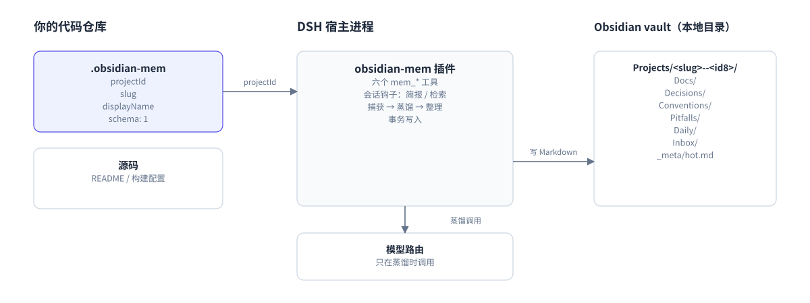

# 01 项目是什么

## 一句话

`dsh-obsidian-mem` 是 DeepSeek Harness（一个 agent 宿主）的插件。
它把项目文档和长期记忆写成纯 Markdown（纯文本格式），存进一个 Obsidian vault。

## 它解决三个问题

1. **会话很短，项目很长。** 会话结束后，决定和踩坑容易丢失。
2. **知识散落。** 决策在聊天里，约定在人脑里，文档在另一个目录里。
3. **记忆被工具锁住。** 换一个 agent 工具，历史记忆常常读不到。

这个插件用三个做法回应：

- 一个仓库对应一个稳定 `projectId`，身份不随目录名变化。
- 记忆写成普通文件，任何编辑器都能读。
- 每次会话自动带回一页简报，需要时再检索全文。

## 三个对象

记住三个对象，就记住了项目的主干。

| 对象 | 位置 | 作用 |
|---|---|---|
| 指针 `.obsidian-mem` | 代码仓库根 | 证明“这个仓库是哪个项目” |
| vault | 本地目录，例如 `~/Documents/dsh-memory` | 保存全部 Markdown 笔记 |
| 插件 | DSH 进程内 | 读写 vault，注入简报，整理记忆 |

图 1：仓库、插件与 vault。箭头表示数据流，不表示进程调用顺序。

图 1 的读法：

- 仓库里的 `.obsidian-mem` 提供 `projectId`。
- 插件用 `projectId` 找到 vault 中的项目目录。
- 插件写入 Markdown。Obsidian 只读取这些文件。
- Codex 适配器（另一个 agent 宿主，见 [11](11-codex.md)）走另一条入口，但复用同一套 `lib/`。

## 它不做什么

| 它不是 | 原因 |
|---|---|
| Obsidian 插件 | Obsidian 不加载它。它只写 Obsidian 能打开的目录。 |
| 笔记应用 | 没有编辑界面。阅读靠 Obsidian 或任意编辑器。 |
| 向量数据库 | 搜索使用 SQLite FTS5（全文搜索），不做语义向量检索。 |
| 备份工具 | 快照只用于失败恢复，不替代备份。 |
| 多人协作系统 | 威胁模型是单用户、本地磁盘。 |
| 同步工具 | vault 必须在本地磁盘。已知云托管目录会被拒绝。 |

## 什么时候适合

| 适合 | 不适合 |
|---|---|
| 长期维护的代码仓库 | 多人同时写同一个 vault |
| 一人或小团队 | 必须使用云端同步目录 |
| 愿意记录决策和踩坑 | 要求全自动、不需要人工审查 |
| vault 放在本地磁盘 | 需要跨机器实时共享记忆 |

## 三条边界

- **项目还年轻。** 当前版本是 0.2.0。真实边界写在 [README 的诚实边界](../../README.zh.md#honest-limits)。
- **写入很保守。** 插件宁可拒绝，也不猜用户意图。拒绝会带错误码。
- **蒸馏会调用模型。** 开启自动蒸馏后，已完成回合的文本会发给你配置的模型路由。

## 下一步

你已知道项目做什么。
下一页安装插件，并写出第一条记忆。

下一页：[02 快速开始](02-quickstart.md)
