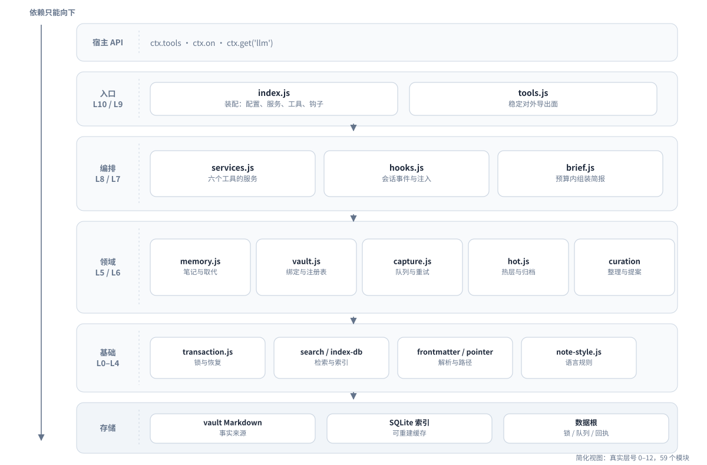

# 04 架构

这页回答两个问题：

- 代码分成哪些部分？
- 为什么这样分？

## 两层：协议与适配

| 层 | 内容 | 是否依赖 DSH |
|---|---|---|
| 协议层 | vault 布局、指针、frontmatter、笔记规则 | 否 |
| 适配层 | 六个工具、会话钩子、自动捕获与蒸馏 | 是 |

协议层是纯 Markdown 约定。
Codex 的 MCP 适配器也复用 `lib/`，所以两个宿主共用同一套规则。

## 五个代码带

下图把 59 个 JS 模块简化成五个带。真实层号是 0 到 12。



图 2：五个代码带。图中只保留主要边界。

| 代码带 | 主要模块 | 职责 |
|---|---|---|
| 入口与门面 | `index.js`、`tools.js` | 装配服务；保持外部 import 路径稳定 |
| 编排 | `services.js`、`hooks.js`、`brief.js` | 工具服务、会话事件、预算简报 |
| 领域 | `memory.js`、`vault.js`、`capture.js`、`hot.js`、`curation-*.js` | 笔记、绑定、队列、热层、整理 |
| 基础 | `transaction.js`、`search.js`、`index-db.js`、`frontmatter.js`、`pointer.js` | 事务、检索、解析、路径 |
| 存储 | vault Markdown、SQLite 索引、数据根 | 持久化 |

## 依赖规则

- 每个模块有固定层号。
- 依赖只能从高层指向低层。
- 同一层不能互相 import。
- 新模块必须登记层号和行数预算。

这些规则不是口头约定。
`test/architecture.test.js` 会读取真实 import 图，检查层号、环和文件大小。
新增模块不登记，测试就失败。

这样做的目的：

- 防止循环依赖。
- 让基础模块可以被单独测试。
- 让“文件变大”成为一次显式决定。

## 一次装配

插件启动时，`lib/index.js` 按固定顺序执行：

1. 校验配置。未知键直接报错。
2. 如果 `enabled: false`，立即返回。不注册任何东西。
3. 解析唯一的数据根 `<data-root>`。
4. 创建六个工具共用的服务集合。
5. 注册六个 `mem_*` 工具。
6. 注册会话钩子。
7. 注册可选的记忆图谱路由。
8. 同步随包技能到 `$DSH_HOME/skills/`。

关键约束：

- `resolveDataRoot()` 只调用一次。这样锁、索引、队列不会指向不同目录。
- `ctx.llm` 不是硬依赖。需要时用 `ctx.get('llm')`。
- 技能同步失败只记录日志，不会让插件加载失败。

## 宿主接缝

插件只依赖少量宿主能力。

| 接缝 | 用法 | 失败时 |
|---|---|---|
| `ctx.tools.register` | 注册六个工具 | 工具不可见 |
| `agent/session-start` | 初始化会话状态 | 会话仍可继续 |
| `agent/pre-step` | 注入简报与检索结果 | 本轮无注入 |
| `session/event` | 观察 `turn/end` | 这个回合不捕获 |
| `session/flush` | 补扫已提交的完成回合 | 退化为仅实时捕获 |
| `ctx.get('llm')` | 蒸馏调用模型 | job 停在 `deferred` |

事件顺序来自实测，不来自猜测。
细节见 `docs/p0-compatibility.md`。

## 模块地图

| 模块 | 层 | 你会在什么时候读它 |
|---|---|---|
| `index.js` | 10 | 改装配顺序、加服务 |
| `tools.js` | 9 | 改对外导出面 |
| `tool-registry.js` | 4 | 改工具名称、描述、参数 |
| `services.js` | 8 | 改六个工具的行为 |
| `hooks.js` | 8 | 改注入时机、会话状态 |
| `brief.js` | 7 | 改简报内容、预算、顺序 |
| `capture.js` | 6 | 改捕获、队列、重试 |
| `distill.js` | 2 | 改蒸馏提示词、校验 |
| `memory.js` | 5 | 改笔记渲染、所有权、取代 |
| `vault.js` | 4 | 改绑定、bootstrap、注册表 |
| `transaction.js` | 3 | 改锁、快照、发布、恢复 |
| `search.js` / `index-db.js` | 3 / 2 | 改检索与索引 |
| `hot.js` | 6 | 改热层容量与归档 |
| `note-style.js` | 0 | 改笔记语言规则 |

## 想改什么，先读哪里

| 你想改 | 先读 | 对应测试 |
|---|---|---|
| 简报里出现什么 | `lib/brief.js` | `test/brief.test.js` |
| 工具参数 | `lib/tool-schema.js`、`lib/tool-registry.js` | `test/tools.test.js` |
| 写入语义 | `lib/memory.js`、`lib/transaction.js` | `test/transaction.test.js` |
| 项目绑定 | `lib/vault.js`、`lib/pointer.js` | `test/binding.test.js` |
| 蒸馏 | `lib/distill.js`、`lib/capture.js` | `test/distill.test.js` |
| 检索 | `lib/index-db.js`、`lib/search.js` | `test/search.test.js` |
| 新增模块 | `test/architecture.test.js` | `npm test` |

跑单个测试文件时，先设置临时 `DSH_HOME`：

```sh
DSH_HOME=$(mktemp -d) node --test test/brief.test.js
```

这样测试写不进真实的 `~/.dsh`。

## 设计取舍

- **一个数据根**：锁、索引、队列、回执共享同一目录，避免各说各话。
- **一个写入口**：所有 vault 修改走事务引擎，崩溃后可恢复。
- **薄适配层**：DSH 与 Codex 只做接线，规则留在 `lib/`。
- **缓存可丢**：索引、记忆视图都能重建。vault 才是事实来源。
- **拒绝优于猜测**：配置、绑定、写入遇到歧义时返回错误码。

## 下一步

你已知道代码如何分层。
下一页跟随一次真实会话，看这些模块如何协作。

下一页：[05 一次会话](05-session.md)
