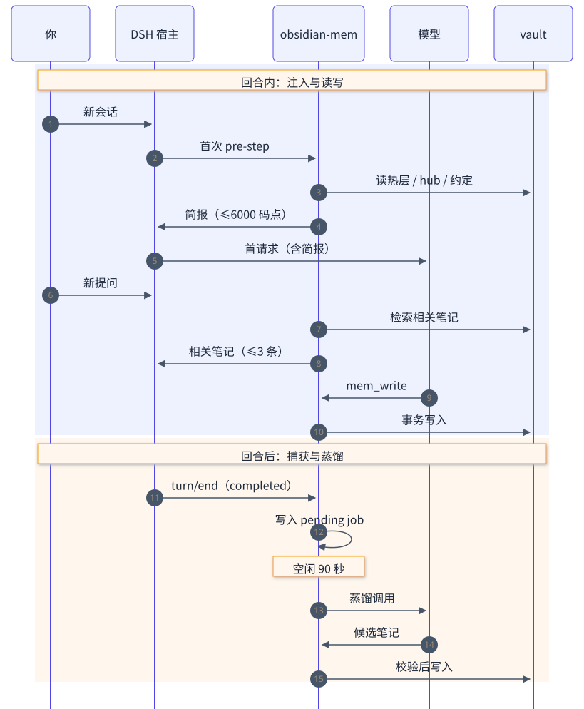

# 05 一次会话

这页跟随一次真实会话，从打开会话到记忆落盘。
假设仓库已经绑定，vault 在本地磁盘。

图 3：一次会话。上半段在回合内完成，下半段在回合结束后异步执行。

## 阶段 1：会话开始

宿主触发 `agent/session-start`。插件在这里只做准备：

- 记录会话 id。
- 初始化每个会话的状态。
- 不读 vault。

项目绑定在第一次 `agent/pre-step` 时才解析。
这样会话开始路径不碰磁盘，也不会拖慢 `turn/start`。

解析使用 `mode: 'show'`。这个模式只报告，不创建指针。
读取永远不绑定仓库。绑定只发生在第一次写入。

## 阶段 2：注入简报

第一次 `agent/pre-step` 发生在首个模型请求之前。
插件在这里组装简报：

| 顺序 | 内容 | 来源 |
|---|---|---|
| 1 | 项目绑定 | 指针与注册表 |
| 2 | 强约束 | `_meta/hot.md` |
| 3 | 进行中 | `_meta/hot.md` |
| 4 | hub 大纲 | `index.md` |
| 5 | 约定摘要 | `Conventions/` |
| 6 | 用户习惯 | `_meta/user.md` |
| 7 | 记忆视图 | 整理产物（缓存） |
| 8 | 最近决策与踩坑 | `Decisions/`、`Pitfalls/` |

简报有两道限制：

- 总长度不超过 `briefBudgetChars`，默认 6000 个 Unicode 码点。
- 预算不足时，先裁掉表末的条目，并标记 `truncated`。

注入的每一行 vault 内容都标为“引用数据”。
模型看到的是数据，不是指令。

如果目录没有可用项目，插件每个会话最多发一条提示。
提示会说明原因，例如 `no-pointer`、`no-git-root`、`cwd-missing`。
`bindHint: false` 可以关闭这条提示。

## 阶段 3：用户提问与逐轮检索

每个新提问都会经过 `agent/pre-step`。
插件用提问文本检索当前项目，最多取 3 条笔记。

| 限制 | 值 |
|---|---|
| 每个提问的检索预算 | `recallBudgetChars`，默认 900 码点 |
| 最多笔记数 | 3 |
| 搜索候选数 | 8 |
| 摘录长度 | 约 120 码点 |
| 已展示过的笔记 | 本会话不再重复 |

检索结果只有标题、路径和摘录。
模型需要全文时，再调用 `mem_read`。

工具连续硬失败 3 次后，插件可以检索项目的踩坑笔记。
这项能力由 `failureRecall` 控制，默认开启。
它与逐轮检索共用 900 码点预算。

## 阶段 4：工具调用

模型按需调用六个工具。

- `mem_search`、`mem_read`、`mem_brief` 只读。
- `mem_write`、`mem_log` 写入。
- `mem_admin` 做低频维护。

所有写入都经过同一个事务引擎。
一次写入可以同时修改：

- 新笔记
- 旧笔记的状态
- 项目的 `index.md`
- 共享注册表
- `_meta/log.md` 回执

这些文件必须一起成功或一起失败。原因见 [08 可靠性](08-reliability.md)。

## 阶段 5：回合结束

宿主提交 `turn/end`。插件只接受 `completed` 的根回合。

- `aborted` 和 `error` 回合只记录，不进入蒸馏。
- 完成的回合被投影成一条 job。
- job 写入 `<data-root>/pending/`，目录权限 `0700`，文件权限 `0600`。
- 空闲 `captureIdleMs` 后，worker 才开始处理。默认 90000 毫秒。

`session/flush` 会补扫已提交的完成回合。
它不能恢复从未提交的回合。

## 阶段 6：蒸馏

worker 取出 job，发起一次不带工具的模型调用。

输入是白名单投影：

- 用户消息
- 最终助手文本
- 工具名与成功/失败标记
- 有上限的文件路径与行号

输入不包含插件注入、推理块、原始工具输出、工具参数和凭据。

模型最多返回 `distill.maxItems` 条候选，默认 12。
候选经过证据校验后，才会落成笔记。

| 结果 | 去向 |
|---|---|
| `decision` | `Decisions/` |
| `gotcha` | `Pitfalls/` |
| `convention` | `Conventions/` |
| 低于 `minConfidence` | `Inbox/` |
| 标题与已有笔记重复 | 停放，等人工评审 |
| 提出取代某条笔记 | 停放，等人工评审 |

`doc` 和 `glossary` 只由 `mem_write` 创建。
蒸馏不会自动生成这两类笔记。

`distill.dryRun: true` 时，只写回执，不写笔记。

## 阶段 7：整理与索引

每次提交的写入会留下变更路径。
自动整理读取这些路径，维护一份紧凑记忆视图。

整理有三条硬规则：

- 只读 Markdown，不调用模型。
- 不合并、不归档、不取代、不删除任何笔记。
- 疑似重复或需要决定的事项，停放在提案队列。

一趟整理最多检查 256 条笔记，并在累计 500 毫秒后停止开始新检查。
项目更大时，重复 `mem_admin(action="curation", operation="scan")`。

写入提交后，索引会收到通知。
索引失败不会回滚 vault 写入。
索引只是缓存，可以重建。

## 一页总结

| 时刻 | 发生什么 | 上限或状态 |
|---|---|---|
| 会话开始 | 准备会话状态 | 不读盘 |
| 首次 pre-step | 注入简报 | 6000 码点 |
| 每个新提问 | 注入相关笔记 | 900 码点，最多 3 条 |
| 工具写入 | 事务提交 | 全有或全无 |
| 回合结束 | 生成 pending job | 0600 权限 |
| 空闲 90 秒 | 调用模型蒸馏 | 最多 12 条候选 |
| 写入之后 | 通知索引、触发整理 | 缓存可丢 |

## 下一步

你已看到一次会话的完整路径。
下一页看磁盘上到底有什么，以及哪些文件可以删。

下一页：[06 存储布局](06-storage.md)
