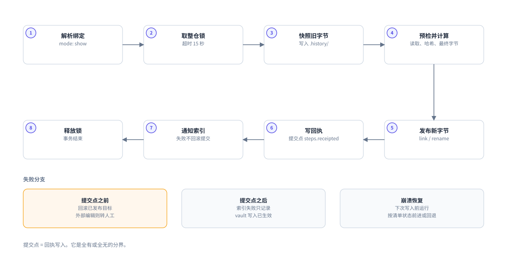
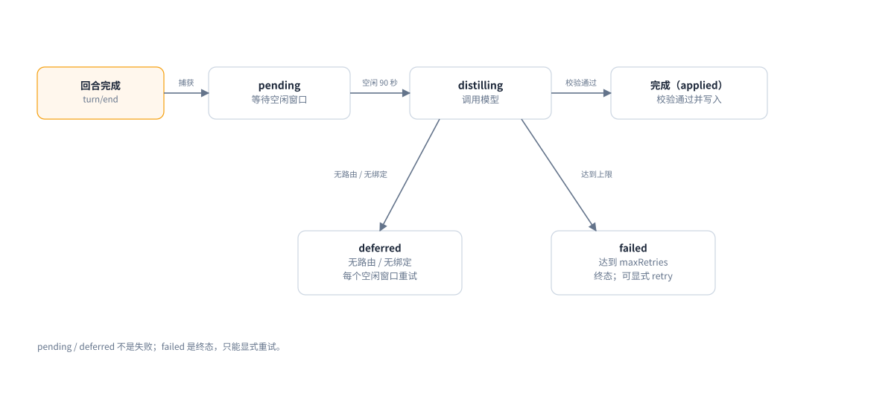

# 08 可靠性

这页解释三件事：

- 一次写入如何保证全有或全无。
- 崩溃后如何恢复。
- 蒸馏与整理失败时，任务去哪里。

## 为什么需要事务

一次笔记写入不只改一个文件。
它可以同时修改：

- 新笔记
- 旧笔记的 `status`
- 项目 `index.md`
- 共享注册表 `_meta/registry.md`
- 回执 `_meta/log.md`

如果进程在中间死掉，vault 会留下半条事实。
下一个会话会把半条事实当成真的。

事务引擎解决这个问题。
所有 vault 内容修改都经过 `lib/transaction.js`。

## 写入路径



图 4：写入事务。编号是执行顺序，第二行从右向左继续。

| 阶段 | 做什么 | 失败时 |
|---|---|---|
| PREPARE | 读取目标、计算最终字节、写清单、暂存临时文件、快照旧内容 | 删除暂存，vault 不变 |
| APPLY | 新建用 `link` 发布，更新先校验哈希再用 `rename` | 回滚已发布目标 |
| COMMIT | 保存机器回执，清单标记 `committed`，再通知索引 | 索引失败不回滚写入 |
| ROLLBACK | 仅在当前字节仍等于本次写入的哈希时恢复 | 外部编辑保留，转人工 |

关键点：

- 回执是最后一个目标。`steps.receipted` 是提交点。
- 提交点之前失败，整个事务回滚。
- 提交点之后失败，vault 已经生效，索引可以重建。
- 新建文件用硬链接（link）发布，避免覆盖同时出现的文件。
- 更新文件先重新读取并校验哈希，再替换。

## 锁

写入前先取整仓锁。

| 项目 | 值 |
|---|---|
| 锁范围 | 整个 vault |
| 锁键 | `sha256(realpath(vault))` |
| 默认等待 | 15000 毫秒 |
| 轮询间隔 | 20 毫秒 |
| 抢占 | 只有记录的进程已不存在时才打破 |
| 可重入 | 否 |

锁文件在 `<data-root>/locks/`。
它只约束本插件。Obsidian 和外部编辑器不理会它。
所以每次替换前都要重新校验哈希。

同一进程嵌套获取锁会死锁。
代码路径不得嵌套调用 `withVaultLock`。

## 崩溃恢复

恢复在每一次新写入之前运行，并且持同一把锁。
恢复不是 `try/catch`，而是按清单状态走：

1. 回执已持久：向前完成提交。
2. 目标已发布但未提交：回滚。
3. 只写了暂存：丢弃暂存。

如果崩溃期间有人外部编辑了文件，两个版本都会保留。
事务转为 `needs-manual-repair`。
在人工解决之前，后续自动写入会被阻止。

这是一次有意的停机。
插件不会猜哪一版是对的。

## 读取失败

读取失败不等于空文件。

以下情况会暂停操作并报告：

- `EDEADLK`
- 其他瞬时 I/O 错误
- macOS 按需下载的占位符特征

插件不会把读不到的文件当成空文件覆盖。
在云同步目录中，这个行为尤其重要。

## 队列

回合结束后，job 进入 `<data-root>/pending/`。
每个 job 是一个 JSON 文件，权限 `0600`。



图 5：job 状态。deferred 会重试，failed 需要显式重试。

| 状态           | 含义         | 会继续吗       |
| ------------ | ---------- | ---------- |
| `pending`    | 等待空闲窗口     | 会          |
| `deferred`   | 缺模型路由或项目绑定 | 会，每个空闲窗口重试 |
| `distilling` | 正在调用模型     | 会          |
| `failed`     | 达到最大尝试次数   | 只有显式重试     |

默认 `maxRetries` 是 3。
这里的 3 是总尝试次数：一次调用加两次指数退避（等待逐次变长）。
达到上限后，job 变为终态 `failed`，并保留原始输出。

`deferred` 不是失败。
导入的会话没有模型路由，会一直停在 `deferred`，直到配置路由。

## 模型输出的两道屏障

模型返回的文本先落盘，再校验。

| 状态 | 内容 | 用途 |
|---|---|---|
| `raw-durable` | 完整原始输出 | 崩溃不丢模型的原话 |
| `validated` | 通过证据校验的候选 | 可以进入写入 |

一旦存在 `validated`，它不可替换。
再次写入相同内容是无操作。不同内容会被拒绝。

`too-many-items` 是整批拒绝，不是裁剪。
把 `distill.maxItems` 调大后重试，会重新校验已保存的原始输出，不必再次调用模型。

## 整理提案

自动整理不会修改源笔记。
疑似重复、需要取代的候选会停放在 `<data-root>/curation/proposals/`。

批准只有一条路：

```sh
dsh-obsidian-mem-review --vault /绝对路径/vault <提案 id>
```

命令要求真实终端，并要求逐字输入 `apply <id>` 或 `reject <id>`。
任何 `mem_admin` 动作都不能批准提案。

## 热层容量

`_meta/hot.md` 默认上限 9000 字符。
填充率超过 0.67 时，写入前先归档`已完成`条目。

归档后，原位置留下一行指针：

```text
- [hot-…] 已归档 → [[…/Docs/hot-archive|热记忆归档]]
```

指针不是条目：

- 不会被再次归档。
- 不会被注入简报。
- 不参与条目计数。

热层写满且没有可归档条目时，返回 `hot-over-capacity`。

不要手工编辑 `_meta/hot.md`。
事务会校验读取时的字节，手工改动会导致 `hash-mismatch`。

恢复路径：

1. `mem_admin(action="hot", operation="status")` 查看各区的数字。
2. `mem_admin(action="hot", operation="compact")` 折叠指针并归档最旧条目。

如果 compact 后仍然超限，调大 `hotCapacityChars`，再重启宿主。

## 失败时的原则

- **失败关闭，不猜。** 返回错误码，保留现场。
- **不丢候选。** 无法判断的候选写进 `Inbox/` 或提案队列。
- **不覆盖外部修改。** 冲突转人工。
- **缓存可重建。** 索引、记忆视图、图谱都不影响事实。

## 下一步

你已知道写入与恢复如何工作。
下一页按症状查问题。

下一页：[09 故障排查](09-troubleshooting.md)
