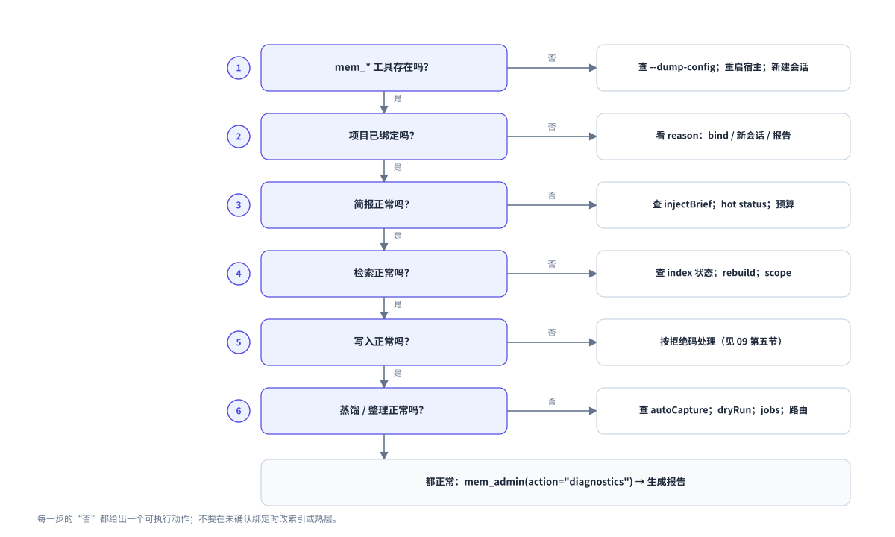

# 09 故障排查

这页按症状查问题。
先走决策树，再查症状表。



图 6：分诊顺序。每一步的“否”分支给出一个可执行动作。

## 第一步：确认工具在不在

在会话中让 agent 调用 `mem_search`。
如果工具不存在，问题在安装层，不在记忆层。

```sh
dsh --profile web --dump-config | grep obsidian-mem
```

看不到 `- id: obsidian-mem` 时：

1. 确认安装命令成功。
2. 重启 `dsh web`。
3. 新建会话。

插件代码每个进程只加载一次。
旧会话仍然持有旧实例。

## 第二步：确认项目绑定

让 agent 调用：

```text
mem_brief
```

返回 `status: "unbound"` 时，看 `reason`。

| reason | 含义 | 做法 |
|---|---|---|
| `no-pointer` | 仓库没有 `.obsidian-mem` | `mem_admin(action="bind", mode="local")`，或先写一次 |
| `no-git-root` | 目录不在 Git 仓库中 | `mem_admin(action="bind", mode="local")` |
| `cwd-missing` | 会话记录的目录已不存在 | 在现存目录中新开会话 |
| `pointer-corrupt` | 指针无法解析 | 报告，不要修复或删除 |
| `pointer-unsupported-schema` | `schema` 版本不认识 | 升级插件，或换回匹配版本 |
| `pointer-not-a-file` | 指针路径不是普通文件 | 报告，不要改 |
| `pointer-oversize` | 指针文件过大 | 检查文件内容 |

读取不会创建绑定。
第一次写入才会创建指针，而且只对 Git 仓库自动执行。

## 第三步：确认简报

`mem_brief` 返回 `text` 时，检查三件事：

| 检查 | 方法 |
|---|---|
| 是否关闭了注入 | 配置中的 `injectBrief` 是否为 `false` |
| 是否被预算裁剪 | 返回值的 `truncated` 是否为 `true` |
| 热层是否超限 | `mem_admin(action="hot", operation="status")` |

预算不足时，插件按固定顺序裁剪。
先裁掉的是表末的最近决策。用户习惯和强约束留到最后。
长期 facts 应放进 `Conventions/`，不要堆在热层。

## 第四步：确认检索

搜索没有结果时，按顺序检查：

1. `scope` 是否正确。默认只搜当前项目。
2. 索引是否就绪。`mem_admin(action="index")`。
3. 笔记是否已提交。`mem_search` 只读已落盘内容。
4. 搜索词是否是笔记里出现的词。

`index-not-ready` 表示首次扫描尚未完成。
等待扫描结束，或运行：

```text
mem_admin(action="index", rebuild=true)
```

重建索引不会改动 vault。

## 第五步：确认写入

| 拒绝码 | 含义 | 做法 |
|---|---|---|
| `human-owned` | 文件属于用户 | 不改，写到 `Inbox/` 并报告 |
| `hash-mismatch` | 文件在读取后被改动 | 重新读取，再决定 |
| `vault-cloud-managed` | vault 在云托管目录 | 移到本地磁盘 |
| `lock-corrupt` | 锁文件损坏 | 只删除错误指名的那个文件 |
| `lock-timeout` | 另一个进程持有写锁 | 等待，或确认持有者已退出 |
| `needs-manual-repair` | 崩溃期间发生外部编辑 | 人工比对两个版本 |

`lock-timeout` 时不要删除可读的锁文件。
记录的进程消失后，锁会自动打破。

## 第六步：确认蒸馏

回合没有变成笔记时，按顺序检查：

| 检查 | 命令或位置 |
|---|---|
| 自动捕获是否关闭 | 配置中的 `autoCapture` |
| 回合是否完成 | 只有 `completed` 回合会进入队列 |
| 是否试运行 | 配置中的 `distill.dryRun` |
| 是否有模型路由 | `distill.provider` 与 `distill.model` |
| job 是否失败 | `mem_admin(action="jobs")` |
| job 是否延迟 | 看 `deferredReason` |

常见 job 错误：

| 错误 | 含义 | 做法 |
|---|---|---|
| `no-route` | 没有模型路由 | 设置 `distill.provider` 与 `model` |
| `too-many-items` | 候选数超过 `maxItems` | 调大 `maxItems` 后重试 |
| `truncated` | 模型输出被截断 | 调大 `maxOutputTokens` |
| `failed` | 达到最大尝试次数 | 看 `lastError`，修复后重试 |

重试命令：

```text
mem_admin(action="jobs", jobId="<id>", retry=true)
```

## 第七步：确认整理

提案停在 `pending` 且没有笔记被改动，这是正常行为。
整理不会自动应用任何提案。

| 现象 | 做法 |
|---|---|
| 想看队列 | `mem_admin(action="curation", operation="status")` |
| 想立即扫描 | `mem_admin(action="curation", operation="scan")` |
| 想批准或拒绝 | 运行 `dsh-obsidian-mem-review` |
| 报 `reviewOnly: true` | 按 finding 修源笔记，再扫描 |
| 报 `source-changed` | 重新评审，提案仍在 |
| 报 `review-lock-unavailable` | 稍后重试，不要删私有的 claim 文件 |

## 第八步：看诊断

以上都正常，但行为仍不对时，读本进程的决策环：

```text
mem_admin(action="diagnostics")
```

它返回最近最多 200 条事件，覆盖十类：

`capture`、`distill`、`index`、`bind`、`job`、`transaction`、`brief`、`skill`、`recall`、`curation`。

事件只有时间、类别、结果、错误码和计数。
没有正文、标题、提示词和路径。

需要给 Issue 附报告时：

```sh
dsh-obsidian-mem-diagnose --output ./obsidian-mem-diagnostics.json
```

命令不可用时，在源码目录运行 `node lib/diagnose-cli.js --output ./obsidian-mem-diagnostics.json`。
命令不上传文件，不读真实 vault，不覆盖已有文件。
附上之前先自己读一遍。

## 常见症状表

| 症状 | 常见原因 | 第一步 |
|---|---|---|
| 工具列表没有 `mem_*` | 插件未挂载或未重启 | 查 `--dump-config`，重启，新会话 |
| 会话没有简报 | 未绑定，或 `injectBrief: false` | 调 `mem_brief` 看 `reason` |
| 笔记停止更新 | 文件被卸载或不可读 | 打开这个文件，或移出同步目录 |
| 首次创建骨架时报 `property-type-conflict` | 已有笔记的属性类型冲突 | 改那条笔记，或换空 vault |
| 生成块报告冲突 | 有人改过生成块 | 人工决定保留哪一版 |
| 搜索没有结果 | 索引未就绪或范围不对 | `mem_admin(action="index")` |
| 写作被拒绝，码为 `no-git-root` | 当前目录不是 Git 仓库 | `bind mode=local` |
| 热层写入被拒绝 | 没有可归档条目 | `hot` 的 `status`，再 `compact` |
| 图谱空白 | 索引或记忆视图缓存未就绪 | 刷新页面，或重建索引 |
| 评审命令报 `review-recovery-required` | 上次评审中断 | 再跑评审并 `apply` |

## 下一步

你已能定位常见问题。
下一页面向维护者：命令、测试、发布。

下一页：[10 开发指南](10-development.md)
