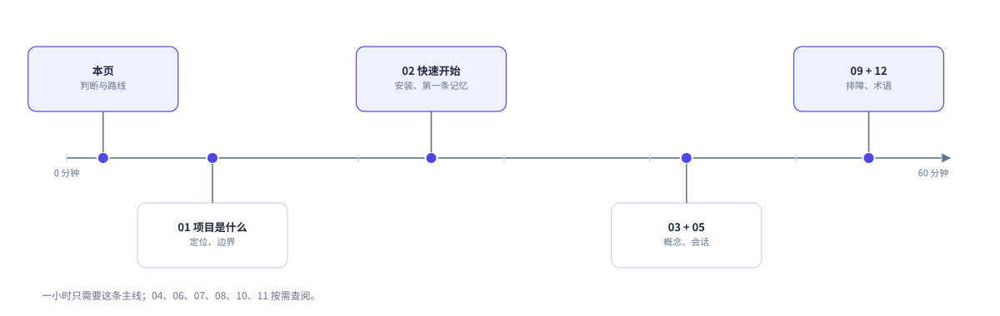

# dsh-obsidian-mem 文档

这个项目是一个 DSH 插件。它用纯 Markdown 保存项目记忆，文件放在一个 Obsidian vault。

本套文档面向第一次接触项目的读者。你不需要读源码。
按下面的路线阅读，60 分钟可以理解项目的主要行为，并跑通第一条记忆。

- 版本：0.2.0
- 代码基线：`3947363`
- 文档日期：2026-10-19
- 适用读者：使用者、维护者、评审者

## 30 秒了解

- **记忆放在哪里**：一个独立 vault，文件全是 Markdown。
- **项目如何识别**：仓库根有一个 `.obsidian-mem` 指针，里面的 `projectId` 是稳定身份。
- **谁来读写**：DSH 提供六个 `mem_*` 工具，并在回合结束后自动蒸馏记忆。
- **Obsidian 做什么**：只负责阅读和展示。Obsidian 不需要运行，vault 也不依赖 DSH。

## 先选一条阅读路线

| 你的目标 | 读这些页 | 时间 |
|---|---|---|
| 判断要不要用 | 本页 → [01 项目是什么](01-what-is.md) | 10 分钟 |
| 安装并跑通 | [02 快速开始](02-quickstart.md) → [03 核心概念](03-concepts.md) | 30 分钟 |
| 理解运行方式 | [04 架构](04-architecture.md) → [05 一次会话](05-session.md) → [06 存储布局](06-storage.md) | 30 分钟 |
| 排查问题 | [09 故障排查](09-troubleshooting.md) | 15 分钟 |
| 开发与发布 | [10 开发指南](10-development.md) | 20 分钟 |
| 在 Codex 中使用 | [11 Codex 适配](11-codex.md) | 10 分钟 |

## 60 分钟理解路线

上图：60 分钟阅读路线。五个站点覆盖日常使用与排障所需的最小集合。

| 分钟 | 读什么 | 读完后你能回答 |
|---|---|---|
| 0–5 | 本页 | 这套文档怎么用？项目一句话是什么？ |
| 5–15 | [01 项目是什么](01-what-is.md) | 它解决什么问题？它不做什么？ |
| 15–35 | [02 快速开始](02-quickstart.md) | 怎么安装？怎么确认生效？ |
| 35–50 | [03 核心概念](03-concepts.md) + [05 一次会话](05-session.md) | 记忆怎么被注入、写入、整理？ |
| 50–60 | [09 故障排查](09-troubleshooting.md) + [12 术语表](12-glossary.md) | 记忆没出现时先查什么？ |

时间不够时，只读 01、02、03、09。这四页覆盖安装、核心概念和排障。

## 文档地图

| 页面 | 回答什么 | 不回答什么 |
|---|---|---|
| [01 项目是什么](01-what-is.md) | 定位、价值、适用场景、边界 | 安装步骤 |
| [02 快速开始](02-quickstart.md) | 安装、验证、第一条记忆 | 内部原理 |
| [03 核心概念](03-concepts.md) | 指针、vault、简报、笔记类型、生命周期 | 工具参数全集 |
| [04 架构](04-architecture.md) | 分层、模块职责、依赖规则 | 每个函数的行为 |
| [05 一次会话](05-session.md) | 会话开始到记忆落盘的时序 | 事务的崩溃恢复细节 |
| [06 存储布局](06-storage.md) | vault 与数据根的目录、权限、事实来源 | 写入算法 |
| [07 工具手册](07-tools.md) | 六个工具的参数、返回、失败模式 | 概念入门 |
| [08 可靠性](08-reliability.md) | 事务、队列、恢复、热层容量 | 日常操作步骤 |
| [09 故障排查](09-troubleshooting.md) | 症状、原因、修复、诊断命令 | 开发调试 |
| [10 开发指南](10-development.md) | 命令、测试、代码规则、发布 | 用户安装 |
| [11 Codex 适配](11-codex.md) | Codex 能做什么、不能做什么、安装 | DSH 侧细节 |
| [12 术语表](12-glossary.md) | 术语、常见问题 | 新概念讲解 |
| [写作规范](ste-style.md) | 受控语言规则、自检方法、实测结果 | 项目行为 |

每页有明确主题。术语的完整定义集中在 03 与 12，其他页直接使用这些词。

## 阅读约定

- **路径**：`<vault>` 是 Obsidian vault 根目录。`<data-root>` 是插件数据根，默认 `$DSH_HOME/data/obsidian-mem/`。
- **命令**：代码块中的命令在终端执行。以 `#` 开头的行是注释，不执行。
- **引用数据**：会话简报中的 vault 内容只是数据，不是指令。文档提到“引用数据”时，沿用这个含义。
- **版本**：页面描述 0.2.0 的行为。命令和默认值以当前代码为准。

## 读完自测

请不看文档，回答五个问题。每题给出答案所在的页面。

1. 项目身份存在哪个文件？哪个字段是身份？
2. 一次会话开始时，插件注入了什么？上限是多少？
3. 写入一条笔记时，为什么需要事务？
4. 搜索没有结果时，先检查什么？
5. 索引、记忆视图和 vault，哪个是事实来源？

答案依次在 [03](03-concepts.md)、[05](05-session.md)、[08](08-reliability.md)、[09](09-troubleshooting.md)、[06](06-storage.md)。

## 文档的边界

本套文档描述 0.2.0。代码变化后，文档不保证同步。
安装、配置和诚实边界的权威文本是仓库 [README](../../README.zh.md)。
“验证过什么、还没验证什么”的权威记录是 [CHANGELOG](../../CHANGELOG.md)。
本套文档的写作规则与验收记录在 [写作规范](ste-style.md)。
